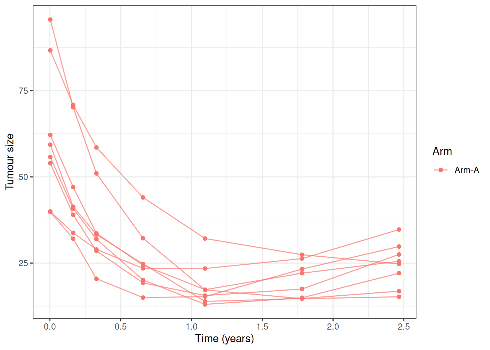
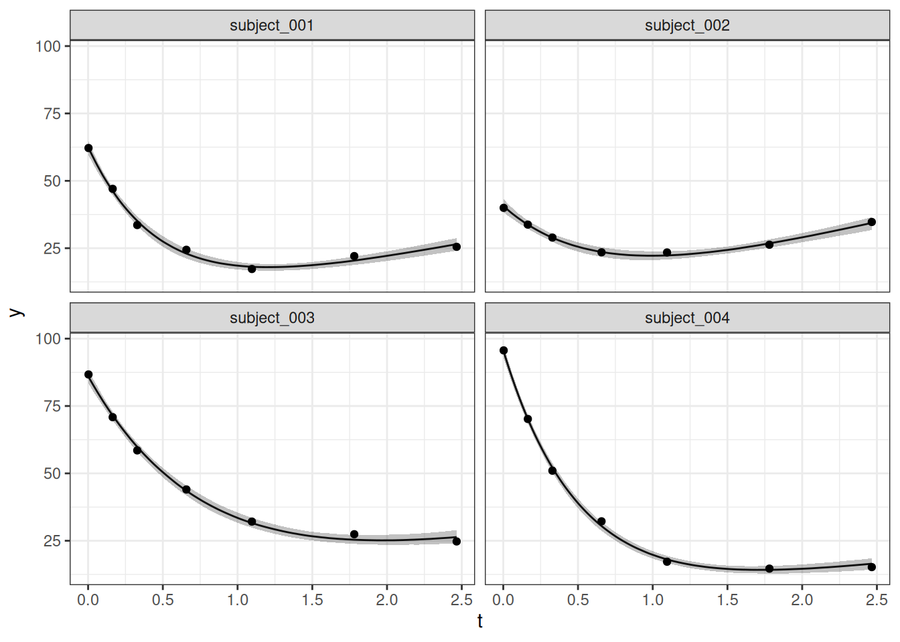
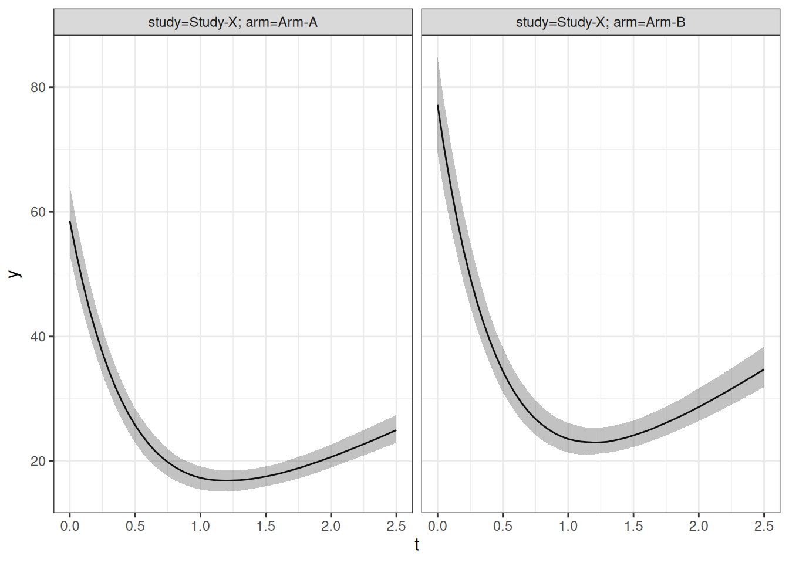

# Fitting a Custom Longitudinal Model with Covariates

## Introduction

This vignette gives a complete implementation of a custom longitudinal
model whose population parameters depend on subject-level covariates. It
extends the Wang, Sung et al. (2009) mixed exponential-decay and
linear-growth example from the [custom longitudinal model
vignette](https://genentech.github.io/jmpost/articles/custom-model.md).
The general extension interfaces are described in [Extending
jmpost](https://genentech.github.io/jmpost/articles/extending-jmpost.md).

We use the longitudinal model

``` math
\begin{align}
y_i(t) &\sim N\left(b_i e^{-s_i t} + g_i t,\ \sigma^2\right), \\
b_i &\sim \operatorname{LogNormal}\left(\eta_{b,i},\ \omega_b\right), \\
s_i &\sim \operatorname{LogNormal}\left(\log(\mu_s),\ \omega_s\right), \\
g_i &\sim \operatorname{LogNormal}\left(\eta_{g,i},\ \omega_g\right), \\
\eta_{b,i} &= \beta_{b,0} + X_{b,i}\beta_b, \\
\eta_{g,i} &= \beta_{g,0} + X_{g,i}\beta_g.
\end{align}
```

Here, $`X_{b,i}`$ and $`X_{g,i}`$ are independently specified
design-matrix rows. Consequently, the baseline and growth distributions
can use different covariates. The intercepts and coefficients are on the
log scale, so the population medians of $`b_i`$ and $`g_i`$ are
positive.

The survival submodel and derivative link are the same as in the example
without longitudinal covariates:

``` math
\log h_i(t) = \log(\lambda_0) +
\alpha\left\{-s_i b_i e^{-s_i t} + g_i\right\}.
```

The example deliberately implements the covariate handling itself. For a
real application, you would of course first check whether one of
`jmpost`’s built-in covariate models already describes the required
trajectory.

\
[`library`](https://rdrr.io/r/base/library.html)`(`[`jmpost`](https://genentech.github.io/jmpost/)`)`\
`#> Registered S3 methods overwritten by 'ggpp':`\
`#>   method                  from   `\
`#>   heightDetails.titleGrob ggplot2`\
`#>   widthDetails.titleGrob  ggplot2`\
`#> CmdStan path set to: /root/.cmdstan/cmdstan-2.40.0`\
[`library`](https://rdrr.io/r/base/library.html)`(`[`ggplot2`](https://ggplot2.tidyverse.org)`)`\
[`library`](https://rdrr.io/r/base/library.html)`(`[`dplyr`](https://dplyr.tidyverse.org)`)`\
`#> `\
`#> Attaching package: 'dplyr'`\
`#> The following objects are masked from 'package:stats':`\
`#> `\
`#>     filter, lag`\
`#> The following objects are masked from 'package:base':`\
`#> `\
`#>     intersect, setdiff, setequal, union`

## Generating Simulated Data

We begin with a simulator so that the fitted arm effects have known
target values. Arm B has a 25% higher median baseline and a 40% higher
median growth rate than Arm A.

\
`SimWangCov`` ``<-`` ``setClass``(`\
`    ``"SimWangCov"``,`\
`    contains ``=`` ``"SimLongitudinal"``,`\
`    slots ``=`` `[`c`](https://rdrr.io/r/base/c.html)`(`\
`        times ``=`` ``"numeric"``,`\
`        mu_baseline ``=`` ``"numeric"``,`\
`        baseline_arm_ratio ``=`` ``"numeric"``,`\
`        mu_shrinkage ``=`` ``"numeric"``,`\
`        mu_growth ``=`` ``"numeric"``,`\
`        growth_arm_ratio ``=`` ``"numeric"``,`\
`        omega_baseline ``=`` ``"numeric"``,`\
`        omega_shrinkage ``=`` ``"numeric"``,`\
`        omega_growth ``=`` ``"numeric"``,`\
`        sigma ``=`` ``"numeric"``,`\
`        link_dsld ``=`` ``"numeric"`\
`    ``)`\
`)`\
\
`sampleSubjects.SimWangCov`` ``<-`` ``function``(``object``, ``subjects_df``)`` ``{`\
`    ``arm_b`` ``<-`` `[`as.numeric`](https://rdrr.io/r/base/numeric.html)`(``subjects_df``$``arm`` ``==`` ``"Arm-B"``)`\
`    ``n_subjects`` ``<-`` `[`nrow`](https://rdrr.io/r/base/nrow.html)`(``subjects_df``)`\
\
`    ``subjects_df``$``baseline`` ``<-`` `[`rlnorm`](https://rdrr.io/r/stats/Lognormal.html)`(`\
`        ``n_subjects``,`\
`        `[`log`](https://rdrr.io/r/base/Log.html)`(``object``@``mu_baseline``)`` ``+`` `[`log`](https://rdrr.io/r/base/Log.html)`(``object``@``baseline_arm_ratio``)`` ``*`` ``arm_b``,`\
`        ``object``@``omega_baseline`\
`    ``)`\
`    ``subjects_df``$``shrinkage`` ``<-`` `[`rlnorm`](https://rdrr.io/r/stats/Lognormal.html)`(`\
`        ``n_subjects``,`\
`        `[`log`](https://rdrr.io/r/base/Log.html)`(``object``@``mu_shrinkage``)``,`\
`        ``object``@``omega_shrinkage`\
`    ``)`\
`    ``subjects_df``$``growth`` ``<-`` `[`rlnorm`](https://rdrr.io/r/stats/Lognormal.html)`(`\
`        ``n_subjects``,`\
`        `[`log`](https://rdrr.io/r/base/Log.html)`(``object``@``mu_growth``)`` ``+`` `[`log`](https://rdrr.io/r/base/Log.html)`(``object``@``growth_arm_ratio``)`` ``*`` ``arm_b``,`\
`        ``object``@``omega_growth`\
`    ``)`\
`    ``subjects_df`\
`}`\
\
`sampleObservations.SimWangCov`` ``<-`` ``function``(``object``, ``times_df``)`` ``{`\
`    ``expected`` ``<-`` `[`with`](https://rdrr.io/r/base/with.html)`(`\
`        ``times_df``,`\
`        ``baseline`` ``*`` `[`exp`](https://rdrr.io/r/base/Log.html)`(``-``shrinkage`` ``*`` ``time``)`` ``+`` ``growth`` ``*`` ``time`\
`    ``)`\
`    ``derivative`` ``<-`` `[`with`](https://rdrr.io/r/base/with.html)`(`\
`        ``times_df``,`\
`        ``growth`` ``-`` ``baseline`` ``*`` ``shrinkage`` ``*`` `[`exp`](https://rdrr.io/r/base/Log.html)`(``-``shrinkage`` ``*`` ``time``)`\
`    ``)`\
\
`    ``times_df``$``sld`` ``<-`` `[`rnorm`](https://rdrr.io/r/stats/Normal.html)`(`[`nrow`](https://rdrr.io/r/base/nrow.html)`(``times_df``)``, ``expected``, ``object``@``sigma``)`\
`    ``times_df``$``log_haz_link`` ``<-`` ``object``@``link_dsld`` ``*`` ``derivative`\
`    ``times_df`\
`}`\
\
[`set.seed`](https://rdrr.io/r/base/Random.html)`(``7294``)`\
`simulated`` ``<-`` `[`SimJointData`](https://genentech.github.io/jmpost/reference/SimJointData-class.md)`(`\
`    design ``=`` `[`list`](https://rdrr.io/r/base/list.html)`(`\
`        `[`SimGroup`](https://genentech.github.io/jmpost/reference/SimGroup-class.md)`(``25``, ``"Arm-A"``, ``"Study-X"``)``,`\
`        `[`SimGroup`](https://genentech.github.io/jmpost/reference/SimGroup-class.md)`(``25``, ``"Arm-B"``, ``"Study-X"``)`\
`    ``)``,`\
`    survival ``=`` `[`SimSurvivalExponential`](https://genentech.github.io/jmpost/reference/SimSurvivalExponential.md)`(`\
`        lambda ``=`` ``365`` ``/`` ``500``,`\
`        time_max ``=`` ``3``,`\
`        time_step ``=`` ``1`` ``/`` ``365``,`\
`        lambda_censor ``=`` ``1`` ``/`` ``30`\
`    ``)``,`\
`    longitudinal ``=`` ``SimWangCov``(`\
`        times ``=`` `[`c`](https://rdrr.io/r/base/c.html)`(``1``, ``60``, ``120``, ``240``, ``400``, ``650``, ``900``)`` ``/`` ``365``,`\
`        mu_baseline ``=`` ``60``,`\
`        baseline_arm_ratio ``=`` ``1.25``,`\
`        mu_shrinkage ``=`` ``2``,`\
`        mu_growth ``=`` ``10``,`\
`        growth_arm_ratio ``=`` ``1.4``,`\
`        omega_baseline ``=`` ``0.25``,`\
`        omega_shrinkage ``=`` ``0.25``,`\
`        omega_growth ``=`` ``0.25``,`\
`        sigma ``=`` ``1.5``,`\
`        link_dsld ``=`` ``0.02`\
`    ``)``,`\
`    .silent ``=`` ``TRUE`\
`)`\
\
`dat_lm`` ``<-`` ``simulated``@``longitudinal`\
`dat_os`` ``<-`` ``simulated``@``survival`\
\
`dat_lm`` ``|>`\
`    `[`filter`](https://dplyr.tidyverse.org/reference/filter.html)`(``subject`` `[`%in%`](https://rdrr.io/r/base/match.html)` `[`head`](https://rdrr.io/r/utils/head.html)`(`[`unique`](https://rdrr.io/r/base/unique.html)`(``subject``)``, ``8``)``)`` ``|>`\
`    `[`ggplot`](https://ggplot2.tidyverse.org/reference/ggplot.html)`(`[`aes`](https://ggplot2.tidyverse.org/reference/aes.html)`(``time``, ``sld``, group ``=`` ``subject``, colour ``=`` ``arm``)``)`` ``+`\
`    `[`geom_line`](https://ggplot2.tidyverse.org/reference/geom_path.html)`(``alpha ``=`` ``0.7``)`` ``+`\
`    `[`geom_point`](https://ggplot2.tidyverse.org/reference/geom_point.html)`(``)`` ``+`\
`    `[`labs`](https://ggplot2.tidyverse.org/reference/labs.html)`(``x ``=`` ``"Time (years)"``, y ``=`` ``"Tumour size"``, colour ``=`` ``"Arm"``)`` ``+`\
`    `[`theme_bw`](https://ggplot2.tidyverse.org/reference/ggtheme.html)`(``)`



## Defining the Covariate-Aware Model

A custom covariate model needs to retain its formulas so that the same
design can be reconstructed for fitting and prediction. We therefore add
two formula slots to the `LongitudinalModel` subclass.

\
`.WangCovModel`` ``<-`` ``setClass``(`\
`    ``"WangCovModel"``,`\
`    contains ``=`` ``"LongitudinalModel"``,`\
`    slots ``=`` `[`c`](https://rdrr.io/r/base/c.html)`(`\
`        baseline_formula ``=`` ``"formula"``,`\
`        growth_formula ``=`` ``"formula"`\
`    ``)`\
`)`\
\
`WangCovModel`` ``<-`` ``function``(``baseline_formula`` ``=`` ``~``arm``,`\
`                         ``growth_formula`` ``=`` ``~``arm``)`` ``{`\
`    `[`stopifnot`](https://rdrr.io/r/base/stopifnot.html)`(`\
`        `[`inherits`](https://rdrr.io/r/base/class.html)`(``baseline_formula``, ``"formula"``)``,`\
`        `[`length`](https://rdrr.io/r/base/length.html)`(``baseline_formula``)`` ``==`` ``2``,`\
`        `[`inherits`](https://rdrr.io/r/base/class.html)`(``growth_formula``, ``"formula"``)``,`\
`        `[`length`](https://rdrr.io/r/base/length.html)`(``growth_formula``)`` ``==`` ``2`\
`    ``)`\
\
`    ``.WangCovModel``(`\
`        `[`LongitudinalModel`](https://genentech.github.io/jmpost/reference/LongitudinalModel-class.md)`(`\
`            name ``=`` ``"Wang with Covariates"``,`\
`            stan ``=`` `[`StanModule`](https://genentech.github.io/jmpost/reference/StanModule-class.md)`(``"custom-cov-model.stan"``)``,`\
`            scaled_variance ``=`` ``FALSE``,`\
`            parameters ``=`` `[`ParameterList`](https://genentech.github.io/jmpost/reference/ParameterList-class.md)`(`\
`                `[`Parameter`](https://genentech.github.io/jmpost/reference/Parameter-class.md)`(`\
`                    name ``=`` ``"log_mu_baseline"``,`\
`                    prior ``=`` `[`prior_normal`](https://genentech.github.io/jmpost/reference/prior_normal.md)`(`[`log`](https://rdrr.io/r/base/Log.html)`(``60``)``, ``0.5``)`\
`                ``)``,`\
`                `[`Parameter`](https://genentech.github.io/jmpost/reference/Parameter-class.md)`(`\
`                    name ``=`` ``"beta_baseline"``,`\
`                    prior ``=`` `[`prior_normal`](https://genentech.github.io/jmpost/reference/prior_normal.md)`(``0``, ``0.5``)``,`\
`                    size ``=`` ``"p_baseline_cov"`\
`                ``)``,`\
`                `[`Parameter`](https://genentech.github.io/jmpost/reference/Parameter-class.md)`(`\
`                    name ``=`` ``"mu_shrinkage"``,`\
`                    prior ``=`` `[`set_limits`](https://genentech.github.io/jmpost/reference/set_limits.md)`(`\
`                        `[`prior_lognormal`](https://genentech.github.io/jmpost/reference/prior_lognormal.md)`(`[`log`](https://rdrr.io/r/base/Log.html)`(``2``)``, ``0.5``)``,`\
`                        lower ``=`` `[`getOption`](https://rdrr.io/r/base/options.html)`(``"jmpost.double_eps"``)`\
`                    ``)`\
`                ``)``,`\
`                `[`Parameter`](https://genentech.github.io/jmpost/reference/Parameter-class.md)`(`\
`                    name ``=`` ``"log_mu_growth"``,`\
`                    prior ``=`` `[`prior_normal`](https://genentech.github.io/jmpost/reference/prior_normal.md)`(`[`log`](https://rdrr.io/r/base/Log.html)`(``10``)``, ``0.5``)`\
`                ``)``,`\
`                `[`Parameter`](https://genentech.github.io/jmpost/reference/Parameter-class.md)`(`\
`                    name ``=`` ``"beta_growth"``,`\
`                    prior ``=`` `[`prior_normal`](https://genentech.github.io/jmpost/reference/prior_normal.md)`(``0``, ``0.5``)``,`\
`                    size ``=`` ``"p_growth_cov"`\
`                ``)``,`\
`                `[`Parameter`](https://genentech.github.io/jmpost/reference/Parameter-class.md)`(`\
`                    name ``=`` ``"sigma_baseline"``,`\
`                    prior ``=`` `[`set_limits`](https://genentech.github.io/jmpost/reference/set_limits.md)`(`\
`                        `[`prior_lognormal`](https://genentech.github.io/jmpost/reference/prior_lognormal.md)`(`[`log`](https://rdrr.io/r/base/Log.html)`(``0.25``)``, ``0.5``)``,`\
`                        lower ``=`` `[`getOption`](https://rdrr.io/r/base/options.html)`(``"jmpost.double_eps"``)`\
`                    ``)`\
`                ``)``,`\
`                `[`Parameter`](https://genentech.github.io/jmpost/reference/Parameter-class.md)`(`\
`                    name ``=`` ``"sigma_shrinkage"``,`\
`                    prior ``=`` `[`set_limits`](https://genentech.github.io/jmpost/reference/set_limits.md)`(`\
`                        `[`prior_lognormal`](https://genentech.github.io/jmpost/reference/prior_lognormal.md)`(`[`log`](https://rdrr.io/r/base/Log.html)`(``0.25``)``, ``0.5``)``,`\
`                        lower ``=`` `[`getOption`](https://rdrr.io/r/base/options.html)`(``"jmpost.double_eps"``)`\
`                    ``)`\
`                ``)``,`\
`                `[`Parameter`](https://genentech.github.io/jmpost/reference/Parameter-class.md)`(`\
`                    name ``=`` ``"sigma_growth"``,`\
`                    prior ``=`` `[`set_limits`](https://genentech.github.io/jmpost/reference/set_limits.md)`(`\
`                        `[`prior_lognormal`](https://genentech.github.io/jmpost/reference/prior_lognormal.md)`(`[`log`](https://rdrr.io/r/base/Log.html)`(``0.25``)``, ``0.5``)``,`\
`                        lower ``=`` `[`getOption`](https://rdrr.io/r/base/options.html)`(``"jmpost.double_eps"``)`\
`                    ``)`\
`                ``)``,`\
`                `[`Parameter`](https://genentech.github.io/jmpost/reference/Parameter-class.md)`(`\
`                    name ``=`` ``"sigma"``,`\
`                    prior ``=`` `[`set_limits`](https://genentech.github.io/jmpost/reference/set_limits.md)`(`\
`                        `[`prior_lognormal`](https://genentech.github.io/jmpost/reference/prior_lognormal.md)`(`[`log`](https://rdrr.io/r/base/Log.html)`(``1.5``)``, ``0.5``)``,`\
`                        lower ``=`` `[`getOption`](https://rdrr.io/r/base/options.html)`(``"jmpost.double_eps"``)`\
`                    ``)`\
`                ``)``,`\
`                `[`Parameter`](https://genentech.github.io/jmpost/reference/Parameter-class.md)`(`\
`                    name ``=`` ``"baseline_idv"``,`\
`                    prior ``=`` `[`set_limits`](https://genentech.github.io/jmpost/reference/set_limits.md)`(`\
`                        `[`prior_init_only`](https://genentech.github.io/jmpost/reference/prior_init_only.md)`(`[`prior_lognormal`](https://genentech.github.io/jmpost/reference/prior_lognormal.md)`(`[`log`](https://rdrr.io/r/base/Log.html)`(``60``)``, ``0.5``)``)``,`\
`                        lower ``=`` `[`getOption`](https://rdrr.io/r/base/options.html)`(``"jmpost.double_eps"``)`\
`                    ``)``,`\
`                    size ``=`` ``"n_subjects"`\
`                ``)``,`\
`                `[`Parameter`](https://genentech.github.io/jmpost/reference/Parameter-class.md)`(`\
`                    name ``=`` ``"shrinkage_idv"``,`\
`                    prior ``=`` `[`set_limits`](https://genentech.github.io/jmpost/reference/set_limits.md)`(`\
`                        `[`prior_init_only`](https://genentech.github.io/jmpost/reference/prior_init_only.md)`(`[`prior_lognormal`](https://genentech.github.io/jmpost/reference/prior_lognormal.md)`(`[`log`](https://rdrr.io/r/base/Log.html)`(``2``)``, ``0.5``)``)``,`\
`                        lower ``=`` `[`getOption`](https://rdrr.io/r/base/options.html)`(``"jmpost.double_eps"``)`\
`                    ``)``,`\
`                    size ``=`` ``"n_subjects"`\
`                ``)``,`\
`                `[`Parameter`](https://genentech.github.io/jmpost/reference/Parameter-class.md)`(`\
`                    name ``=`` ``"growth_idv"``,`\
`                    prior ``=`` `[`set_limits`](https://genentech.github.io/jmpost/reference/set_limits.md)`(`\
`                        `[`prior_init_only`](https://genentech.github.io/jmpost/reference/prior_init_only.md)`(`[`prior_lognormal`](https://genentech.github.io/jmpost/reference/prior_lognormal.md)`(`[`log`](https://rdrr.io/r/base/Log.html)`(``10``)``, ``0.5``)``)``,`\
`                        lower ``=`` `[`getOption`](https://rdrr.io/r/base/options.html)`(``"jmpost.double_eps"``)`\
`                    ``)``,`\
`                    size ``=`` ``"n_subjects"`\
`                ``)`\
`            ``)`\
`        ``)``,`\
`        baseline_formula ``=`` ``baseline_formula``,`\
`        growth_formula ``=`` ``growth_formula`\
`    ``)`\
`}`\
\
`longmodel`` ``<-`` ``WangCovModel``(`\
`    baseline_formula ``=`` ``~``arm``,`\
`    growth_formula ``=`` ``~``arm`\
`)`

The corresponding Stan program declares the two model-specific design
matrices. It uses them to form subject-specific log-normal locations and
also populates `long_obvs_log_lik`, which keeps the standard likelihood
and `loo` processing available.

``` stan
functions {
    vector sld(vector time, vector baseline, vector shrinkage, vector growth) {
        return baseline .* exp(-shrinkage .* time) + growth .* time;
    }
}

data {
    int<lower=0> p_baseline_cov;
    matrix[n_subjects, p_baseline_cov] baseline_cov_design;
    int<lower=0> p_growth_cov;
    matrix[n_subjects, p_growth_cov] growth_cov_design;
}

transformed parameters {
    vector[n_subjects] baseline_location =
        rep_vector(log_mu_baseline, n_subjects) +
        baseline_cov_design * beta_baseline;
    vector[n_subjects] growth_location =
        rep_vector(log_mu_growth, n_subjects) +
        growth_cov_design * beta_growth;

    vector[n_tumour_all] Ypred = sld(
        tumour_time,
        baseline_idv[subject_tumour_index],
        shrinkage_idv[subject_tumour_index],
        growth_idv[subject_tumour_index]
    );

    long_obvs_log_lik[subject_tumour_index_obs] = vect_normal_log_dens(
        tumour_value[subject_tumour_index_obs],
        Ypred[subject_tumour_index_obs],
        rep_vector(sigma, n_tumour_obs)
    );
    if (n_tumour_cens > 0) {
        long_obvs_log_lik[subject_tumour_index_cens] = vect_normal_log_cum(
            tumour_value_lloq,
            Ypred[subject_tumour_index_cens],
            rep_vector(sigma, n_tumour_cens)
        );
    }
}

model {
    baseline_idv ~ lognormal(baseline_location, sigma_baseline);
    shrinkage_idv ~ lognormal(log(mu_shrinkage), sigma_shrinkage);
    growth_idv ~ lognormal(growth_location, sigma_growth);
}
```

## Supplying Model-Specific Stan Data

[`DataLongitudinal()`](https://genentech.github.io/jmpost/reference/DataLongitudinal-class.md)
deliberately continues to use an `outcome ~ time` formula. Longitudinal
covariates are subject-level variables and belong in the data passed to
[`DataSubject()`](https://genentech.github.io/jmpost/reference/DataSubject-class.md).
A `longitudinal_model_stan_data.<class>()` method turns those variables
into the model-specific Stan data.

The helper below removes the usual intercept column because the Stan
model has explicit intercept parameters. Its `reference` argument
preserves the fitted factor levels, contrasts, and column order when the
same formula is applied to new population profiles.

\
`covariate_design`` ``<-`` ``function``(``formula``, ``data``, ``reference`` ``=`` ``data``)`` ``{`\
`    ``reference_frame`` ``<-`` `[`model.frame`](https://rdrr.io/r/stats/model.frame.html)`(`\
`        ``formula``,`\
`        data ``=`` ``reference``,`\
`        na.action ``=`` ``na.fail`\
`    ``)`\
`    ``formula_terms`` ``<-`` `[`terms`](https://rdrr.io/r/stats/terms.html)`(``reference_frame``)`\
`    ``reference_design`` ``<-`` `[`model.matrix`](https://rdrr.io/r/stats/model.matrix.html)`(``formula_terms``, ``reference_frame``)`\
\
`    ``data_frame`` ``<-`` `[`model.frame`](https://rdrr.io/r/stats/model.frame.html)`(`\
`        ``formula_terms``,`\
`        data ``=`` ``data``,`\
`        xlev ``=`` ``stats``::`[`.getXlevels`](https://rdrr.io/r/stats/checkMFClasses.html)`(``formula_terms``, ``reference_frame``)``,`\
`        na.action ``=`` ``na.fail`\
`    ``)`\
`    ``design`` ``<-`` `[`model.matrix`](https://rdrr.io/r/stats/model.matrix.html)`(`\
`        ``formula_terms``,`\
`        ``data_frame``,`\
`        contrasts.arg ``=`` `[`attr`](https://rdrr.io/r/base/attr.html)`(``reference_design``, ``"contrasts"``)`\
`    ``)`\
`    ``design``[``, `[`colnames`](https://rdrr.io/r/base/colnames.html)`(``design``)`` ``!=`` ``"(Intercept)"``, drop ``=`` ``FALSE``]`\
`}`\
\
`longitudinal_model_stan_data.WangCovModel`` ``<-`` ``function``(``model``, ``subject``)`` ``{`\
`    ``subject_data`` ``<-`` `[`as.data.frame`](https://rdrr.io/r/base/as.data.frame.html)`(``subject``)`\
`    ``baseline_design`` ``<-`` ``covariate_design``(`\
`        ``model``@``baseline_formula``,`\
`        ``subject_data`\
`    ``)`\
`    ``growth_design`` ``<-`` ``covariate_design``(`\
`        ``model``@``growth_formula``,`\
`        ``subject_data`\
`    ``)`\
\
`    `[`list`](https://rdrr.io/r/base/list.html)`(`\
`        p_baseline_cov ``=`` `[`ncol`](https://rdrr.io/r/base/nrow.html)`(``baseline_design``)``,`\
`        baseline_cov_design ``=`` ``baseline_design``,`\
`        p_growth_cov ``=`` `[`ncol`](https://rdrr.io/r/base/nrow.html)`(``growth_design``)``,`\
`        growth_cov_design ``=`` ``growth_design`\
`    ``)`\
`}`

The method name must end in the exact S4 class name. `jmpost` calls it
while converting `DataJoint` to Stan data, so users do not need to
construct or append the matrices themselves.

## Defining the Link Function

The link setup is unchanged by the population covariates: downstream
link functions consume the realized subject parameters.

\
`enableLink.WangCovModel`` ``<-`` ``function``(``object``, ``...``)`` ``{`\
`    ``object``@``stan`` ``<-`` `[`merge`](https://genentech.github.io/jmpost/reference/merge.md)`(`\
`        ``object``@``stan``,`\
`        `[`StanModule`](https://genentech.github.io/jmpost/reference/StanModule-class.md)`(``"custom-cov-model-enable-link.stan"``)`\
`    ``)`\
`    ``object`\
`}`\
\
`link`` ``<-`` `[`LinkComponent`](https://genentech.github.io/jmpost/reference/LinkComponent-class.md)`(`\
`    stan ``=`` `[`StanModule`](https://genentech.github.io/jmpost/reference/StanModule-class.md)`(``"custom-cov-model-dsld.stan"``)``,`\
`    prior ``=`` `[`prior_normal`](https://genentech.github.io/jmpost/reference/prior_normal.md)`(``0``, ``0.5``)``,`\
`    key ``=`` ``"link_dsld"`\
`)`

``` stan
transformed parameters {
    matrix[n_subjects, 3] link_function_inputs;
    link_function_inputs[, 1] = baseline_idv;
    link_function_inputs[, 2] = shrinkage_idv;
    link_function_inputs[, 3] = growth_idv;
}
```

``` stan
functions {
    matrix link_dsld_contrib(matrix time, matrix link_function_inputs) {
        int nrow = rows(time);
        int ncol = cols(time);
        matrix[nrow, ncol] baseline = rep_matrix(link_function_inputs[, 1], ncol);
        matrix[nrow, ncol] shrinkage = rep_matrix(link_function_inputs[, 2], ncol);
        matrix[nrow, ncol] growth = rep_matrix(link_function_inputs[, 3], ncol);
        return growth - baseline .* shrinkage .* exp(-shrinkage .* time);
    }
}
```

## Sampling the Joint Model

The subject data contains `arm`, which is used by both longitudinal
formulas. The survival formula has no additional covariates in this
simple example.

\
`model`` ``<-`` `[`JointModel`](https://genentech.github.io/jmpost/reference/JointModel-class.md)`(`\
`    longitudinal ``=`` ``longmodel``,`\
`    survival ``=`` `[`SurvivalExponential`](https://genentech.github.io/jmpost/reference/SurvivalExponential-class.md)`(``lambda ``=`` `[`prior_gamma`](https://genentech.github.io/jmpost/reference/prior_gamma.md)`(``1``, ``1``)``)``,`\
`    link ``=`` ``link`\
`)`\
\
`joint_data`` ``<-`` `[`DataJoint`](https://genentech.github.io/jmpost/reference/DataJoint-class.md)`(`\
`    subject ``=`` `[`DataSubject`](https://genentech.github.io/jmpost/reference/DataSubject-class.md)`(`\
`        data ``=`` ``dat_os``,`\
`        subject ``=`` ``"subject"``,`\
`        arm ``=`` ``"arm"``,`\
`        study ``=`` ``"study"`\
`    ``)``,`\
`    survival ``=`` `[`DataSurvival`](https://genentech.github.io/jmpost/reference/DataSurvival-class.md)`(`\
`        data ``=`` ``dat_os``,`\
`        formula ``=`` `[`Surv`](https://genentech.github.io/jmpost/reference/Surv.md)`(``time``, ``event``)`` ``~`` ``1`\
`    ``)``,`\
`    longitudinal ``=`` `[`DataLongitudinal`](https://genentech.github.io/jmpost/reference/DataLongitudinal-class.md)`(`\
`        data ``=`` ``dat_lm``,`\
`        formula ``=`` ``sld`` ``~`` ``time`\
`    ``)`\
`)`\
\
`model_samples`` ``<-`` `[`sampleStanModel`](https://genentech.github.io/jmpost/reference/sampleStanModel.md)`(`\
`    ``model``,`\
`    data ``=`` ``joint_data``,`\
`    iter_warmup ``=`` ``400``,`\
`    iter_sampling ``=`` ``400``,`\
`    chains ``=`` ``1``,`\
`    parallel_chains ``=`` ``1``,`\
`    refresh ``=`` ``0``,`\
`    adapt_delta ``=`` ``0.9`\
`)`

\
`fit`` ``<-`` ``cmdstanr``::`[`as.CmdStanMCMC`](https://mc-stan.org/cmdstanr/reference/cmdstan_coercion.html)`(``model_samples``)`\
`fit``$``summary``(`[`c`](https://rdrr.io/r/base/c.html)`(`\
`    ``"log_mu_baseline"``,`\
`    ``"beta_baseline"``,`\
`    ``"log_mu_growth"``,`\
`    ``"beta_growth"``,`\
`    ``"mu_shrinkage"``,`\
`    ``"sigma"``,`\
`    ``"link_dsld"`\
`)``)`\
`#> # A tibble: 7 × 10`\
`#>   variable     mean median      sd     mad     q5    q95  rhat ess_bulk ess_tail`\
`#>   <chr>       <dbl>  <dbl>   <dbl>   <dbl>  <dbl>  <dbl> <dbl>    <dbl>    <dbl>`\
`#> 1 log_mu_ba… 4.07   4.07   0.0487  0.0486  3.99   4.14   1.00      449.     369.`\
`#> 2 beta_base… 0.279  0.278  0.0705  0.0730  0.163  0.386  1.000     433.     398.`\
`#> 3 log_mu_gr… 2.29   2.29   0.0506  0.0542  2.21   2.38   1.00      457.     342.`\
`#> 4 beta_grow… 0.330  0.330  0.0669  0.0676  0.226  0.437  1.00      349.     359.`\
`#> 5 mu_shrink… 2.06   2.06   0.0836  0.0787  1.93   2.21   1.02      478.     226.`\
`#> 6 sigma      1.51   1.51   0.0754  0.0818  1.40   1.64   1.00      211.     225.`\
`#> 7 link_dsld  0.0297 0.0292 0.00817 0.00890 0.0166 0.0438 1.01      401.     295.`

The true arm coefficients are `log(1.25)` for baseline and `log(1.4)`
for growth. The short, single-chain run keeps vignette execution
manageable; use multiple chains and sampling iterations, and check all
diagnostics, for a real application.

## Enabling Downstream Processing

Individual predictions only need each subject’s fitted parameters
(implemented with `QuantityGeneratorSubject`). Population predictions
additionally need design matrices evaluated at the requested covariate
profiles (implemented with `QuantityGeneratorPopulation`). We keep these
cases separate so that Stan code never refers to population-only data
while generating subject-level quantities.

\
`enableGQ.WangCovModel`` ``<-`` ``function``(``object``,`\
`                                  ``generator`` ``=`` ``NULL``,`\
`                                  ``type`` ``=`` ``NULL``,`\
`                                  ``...``)`` ``{`\
`    ``if`` ``(``!`[`identical`](https://rdrr.io/r/base/identical.html)`(``type``, ``"longitudinal"``)``)`` ``{`\
`        `[`return`](https://rdrr.io/r/base/function.html)`(`[`StanModule`](https://genentech.github.io/jmpost/reference/StanModule-class.md)`(``)``)`\
`    ``}`\
\
`    ``result`` ``<-`` `[`StanModule`](https://genentech.github.io/jmpost/reference/StanModule-class.md)`(``"custom-cov-model-gq.stan"``)`\
`    ``if`` ``(``is``(``generator``, ``"QuantityGeneratorSubject"``)``)`` ``{`\
`        ``result`` ``<-`` `[`merge`](https://genentech.github.io/jmpost/reference/merge.md)`(`\
`            ``result``,`\
`            `[`StanModule`](https://genentech.github.io/jmpost/reference/StanModule-class.md)`(``"custom-cov-model-gq-individual.stan"``)`\
`        ``)`\
`    ``}`` ``else`` ``if`` ``(``is``(``generator``, ``"QuantityGeneratorPopulation"``)``)`` ``{`\
`        ``result`` ``<-`` `[`merge`](https://genentech.github.io/jmpost/reference/merge.md)`(`\
`            ``result``,`\
`            `[`StanModule`](https://genentech.github.io/jmpost/reference/StanModule-class.md)`(``"custom-cov-model-gq-population.stan"``)`\
`        ``)`\
`    ``}`\
`    ``result`\
`}`\
\
`required_longitudinal_covs.WangCovModel`` ``<-`` ``function``(``object``, ``...``)`` ``{`\
`    `[`unique`](https://rdrr.io/r/base/unique.html)`(`[`c`](https://rdrr.io/r/base/c.html)`(`\
`        `[`all.vars`](https://rdrr.io/r/base/allnames.html)`(``object``@``baseline_formula``)``,`\
`        `[`all.vars`](https://rdrr.io/r/base/allnames.html)`(``object``@``growth_formula``)`\
`    ``)``)`\
`}`\
\
`gq_population_stan_data.WangCovModel`` ``<-`` ``function``(``object``,`\
`                                                 ``model``,`\
`                                                 ``data`` ``=`` ``NULL``,`\
`                                                 ``...``)`` ``{`\
`    ``result`` ``<-`` `[`list`](https://rdrr.io/r/base/list.html)`(`\
`        declarations ``=`` `[`paste`](https://rdrr.io/r/base/paste.html)`(`\
`            ``"matrix[gq_n_quant, p_baseline_cov] gq_baseline_cov_design;"``,`\
`            ``"matrix[gq_n_quant, p_growth_cov] gq_growth_cov_design;"``,`\
`            sep ``=`` ``"\n"`\
`        ``)``,`\
`        data ``=`` `[`list`](https://rdrr.io/r/base/list.html)`(``)`\
`    ``)`\
`    ``if`` ``(`[`is.null`](https://rdrr.io/r/base/NULL.html)`(``data``)``)`` ``{`\
`        `[`return`](https://rdrr.io/r/base/function.html)`(``result``)`\
`    ``}`\
\
`    `[`stopifnot`](https://rdrr.io/r/base/stopifnot.html)`(``!`[`is.null`](https://rdrr.io/r/base/NULL.html)`(``object``@``newdata``)``)`\
`    ``subject_data`` ``<-`` `[`as.data.frame`](https://rdrr.io/r/base/as.data.frame.html)`(``data``@``subject``)`\
`    ``result``$``data`` ``<-`` `[`list`](https://rdrr.io/r/base/list.html)`(`\
`        gq_baseline_cov_design ``=`` ``covariate_design``(`\
`            ``model``@``baseline_formula``,`\
`            ``object``@``newdata``,`\
`            reference ``=`` ``subject_data`\
`        ``)``,`\
`        gq_growth_cov_design ``=`` ``covariate_design``(`\
`            ``model``@``growth_formula``,`\
`            ``object``@``newdata``,`\
`            reference ``=`` ``subject_data`\
`        ``)`\
`    ``)`\
`    ``result`\
`}`\
\
`getRandomEffectsNames.WangCovModel`` ``<-`` ``function``(``object``, ``...``)`` ``{`\
`    `[`c`](https://rdrr.io/r/base/c.html)`(`\
`        baseline ``=`` ``"baseline_idv"``,`\
`        shrinkage ``=`` ``"shrinkage_idv"``,`\
`        growth ``=`` ``"growth_idv"`\
`    ``)`\
`}`

The shared prediction function is:

``` stan
functions {
    vector lm_predict_value(vector time, matrix long_gq_parameters) {
        return sld(
            time,
            long_gq_parameters[, 1],
            long_gq_parameters[, 2],
            long_gq_parameters[, 3]
        );
    }
}
```

The subject-level and covariate-aware population parameter blocks are:

``` stan
generated quantities {
    matrix[n_subjects, 3] long_gq_parameters;
    long_gq_parameters[, 1] = baseline_idv;
    long_gq_parameters[, 2] = shrinkage_idv;
    long_gq_parameters[, 3] = growth_idv;
}

generated quantities {
    matrix[gq_n_quant, 3] long_gq_pop_parameters;
    long_gq_pop_parameters[, 1] = exp(
        rep_vector(log_mu_baseline, gq_n_quant) +
        gq_baseline_cov_design * beta_baseline
    );
    long_gq_pop_parameters[, 2] = rep_vector(mu_shrinkage, gq_n_quant);
    long_gq_pop_parameters[, 3] = exp(
        rep_vector(log_mu_growth, gq_n_quant) +
        gq_growth_cov_design * beta_growth
    );
}
```

We can now run the downstream methods. First, extract and summarize the
three subject-level random effects:

\
`random_effects`` ``<-`` `[`LongitudinalRandomEffects`](https://genentech.github.io/jmpost/reference/LongitudinalRandomEffects.md)`(``model_samples``)`\
[`head`](https://rdrr.io/r/utils/head.html)`(`[`summary`](https://rdrr.io/r/base/summary.html)`(``random_effects``)``)`\
`#>       subject parameter    median     lower     upper`\
`#> 1 subject_001  baseline 62.565910 59.820982 64.927940`\
`#> 2 subject_001 shrinkage  2.057073  1.836331  2.276294`\
`#> 3 subject_001    growth 10.572748  9.576134 11.536039`\
`#> 4 subject_002  baseline 40.720425 38.428180 43.385924`\
`#> 5 subject_002 shrinkage  1.556811  1.266595  1.807592`\
`#> 6 subject_002    growth 13.581733 12.287296 14.541318`

Next, generate fitted trajectories for selected observed subjects:

\
`selected_subjects`` ``<-`` `[`head`](https://rdrr.io/r/utils/head.html)`(``dat_os``$``subject``, ``4``)`\
`long_quantities_idv`` ``<-`` `[`LongitudinalQuantities`](https://genentech.github.io/jmpost/reference/LongitudinalQuantities-class.md)`(`\
`    ``model_samples``,`\
`    grid ``=`` `[`GridFixed`](https://genentech.github.io/jmpost/reference/Grid-Functions.md)`(``subjects ``=`` ``selected_subjects``)`\
`)`\
[`autoplot`](https://genentech.github.io/jmpost/reference/autoplot.md)`(``long_quantities_idv``)`



Finally, compare population trajectories for the two arm profiles. Each
row of `newdata` is a complete subject profile. It must include `study`
and `arm` for the standard grouping indexes as well as every variable
returned by
[`required_longitudinal_covs()`](https://genentech.github.io/jmpost/reference/required_longitudinal_covs.md).

\
`population_profiles`` ``<-`` `[`data.frame`](https://rdrr.io/r/base/data.frame.html)`(`\
`    study ``=`` ``"Study-X"``,`\
`    arm ``=`` `[`c`](https://rdrr.io/r/base/c.html)`(``"Arm-A"``, ``"Arm-B"``)`\
`)`\
\
`long_quantities_pop`` ``<-`` `[`LongitudinalQuantities`](https://genentech.github.io/jmpost/reference/LongitudinalQuantities-class.md)`(`\
`    ``model_samples``,`\
`    grid ``=`` `[`GridPopulation`](https://genentech.github.io/jmpost/reference/Grid-Functions.md)`(`\
`        times ``=`` `[`seq`](https://rdrr.io/r/base/seq.html)`(``0``, ``2.5``, length.out ``=`` ``51``)``,`\
`        newdata ``=`` ``population_profiles`\
`    ``)`\
`)`\
\
[`head`](https://rdrr.io/r/utils/head.html)`(`[`summary`](https://rdrr.io/r/base/summary.html)`(``long_quantities_pop``)``)`\
`#>                      group time   median    lower    upper`\
`#> 1 study=Study-X; arm=Arm-A 0.00 58.52567 53.09911 64.28430`\
`#> 2 study=Study-X; arm=Arm-B 0.00 77.17657 69.48304 84.86132`\
`#> 3 study=Study-X; arm=Arm-A 0.05 53.29465 48.37269 58.50720`\
`#> 4 study=Study-X; arm=Arm-B 0.05 70.29112 62.98319 77.58497`\
`#> 5 study=Study-X; arm=Arm-A 0.10 48.55997 44.16097 53.43248`\
`#> 6 study=Study-X; arm=Arm-B 0.10 64.19073 57.80714 71.07011`\
[`autoplot`](https://genentech.github.io/jmpost/reference/autoplot.md)`(``long_quantities_pop``)`



This last call exercises the complete covariate-aware path:
[`GridPopulation()`](https://genentech.github.io/jmpost/reference/Grid-Functions.md)
retains the profiles,
[`required_longitudinal_covs()`](https://genentech.github.io/jmpost/reference/required_longitudinal_covs.md)
validates them,
[`gq_population_stan_data()`](https://genentech.github.io/jmpost/reference/gq_population_stan_data.md)
mirrors the fitted design matrices, and the custom generated-quantities
Stan block evaluates the covariate-dependent population parameters.
