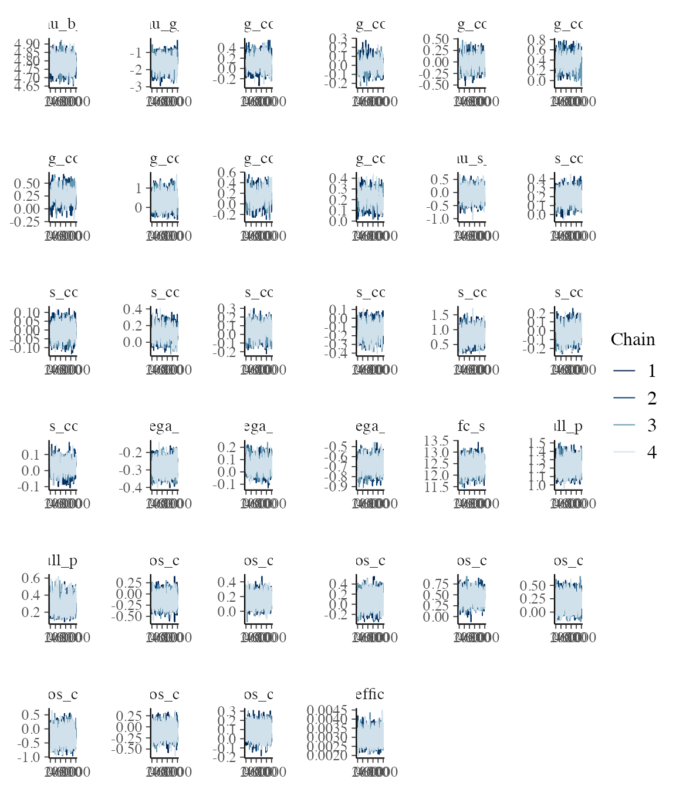
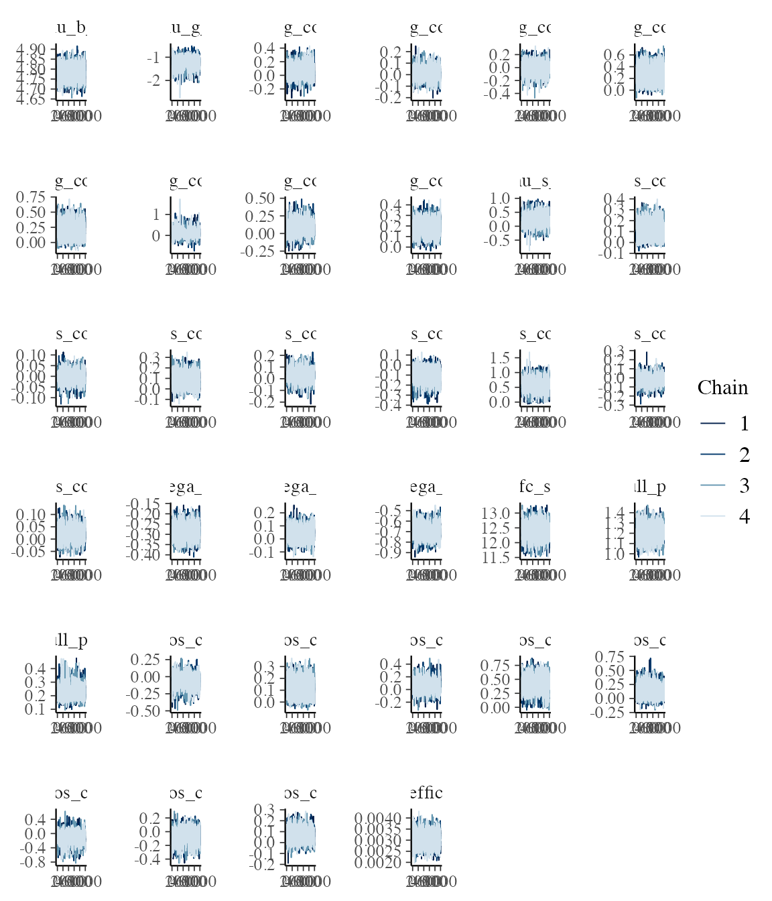
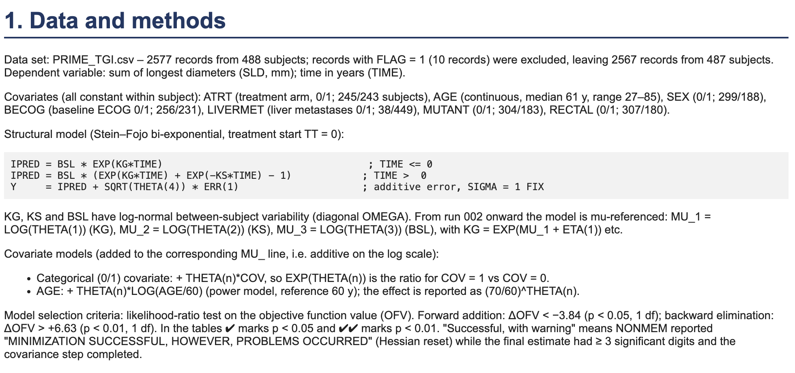
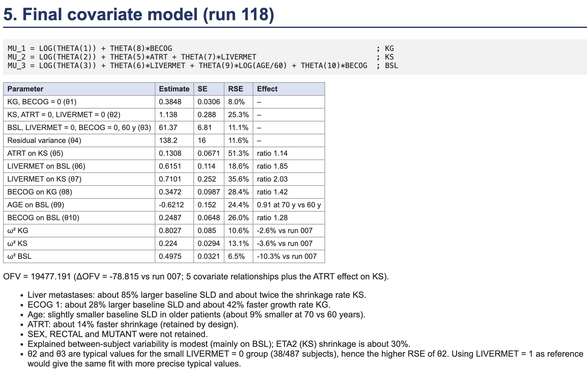
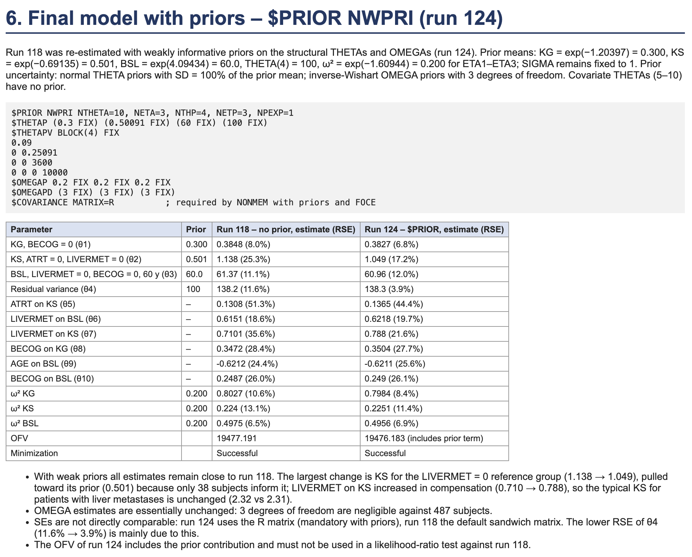

<!-- prime-analysis.qmd is generated from prime-analysis.qmd.orig Please edit that file -->


## Introduction

This vignette prepares data from the PRIME study (ClinicalTrials.gov
[NCT00364013](https://clinicaltrials.gov/study/NCT00364013)) for analysis with
`jmpost`. PRIME was a randomised, multicentre, phase III study in previously
untreated metastatic colorectal cancer. It compared first-line FOLFOX alone
with FOLFOX plus panitumumab: 1,183 participants were randomised, with 590 in
the comparator arm and 593 in the panitumumab arm. The study's primary aim was
to assess whether adding panitumumab improved progression-free survival (PFS),
with overall survival, response, duration of response, time to progression, and
safety assessed as secondary outcomes. The study completed in August 2009.

## Data

We are fortunate to have access to the PRIME study data via Project Data Sphere (RRID:SCR_003726) 
[@project-data-sphere].
The supplied data are ADaM-format SAS datasets. We begin with the
subject-level dataset (`adsl`) to obtain each participant's treatment assignment
and survival or PFS outcome. Longitudinal tumour measurements are taken from
the lesion dataset (`adls`): `VISITDY` provides the analysis time and `LSSLD`
is the sum of longest diameters used as the tumour-size marker. We retain the
participant identifier (`SUBJID`) in both datasets so that the subject-level
event information can be joined to the repeated measurements. The biomarker (`biomark`) dataset contains the KRAS mutation status for each participant.

First we read the datasets from the supplied zip file, using a simple helper function:


``` r
library(jmpost)
zip_file <- system.file("extdata", "prime_subset.zip", package = "jmpost")

adsl <- read_sas7bdat_from_zip(zip_file, "adsl_pds2019.sas7bdat")
adls <- read_sas7bdat_from_zip(zip_file, "adls_pds2019.sas7bdat")
biomark <- read_sas7bdat_from_zip(zip_file, "biomark_pds2019.sas7bdat")
```

Next we create the analysis datasets:


``` r
kras0 <- biomark |>
  dplyr::select("SUBJID", "BMMTR1")

event_df0 <- adsl |>
  dplyr::left_join(kras0, by = "SUBJID") |>
  dplyr::mutate(STUDY = "1", EVENTYR = DTHDY / 365.25, EVENTFL = DTH) |>
  dplyr::select(
    "SUBJID", "STUDY", "ATRT", "EVENTYR", "EVENTFL",
    "AGE", "SEX",
    ECOG = "B_ECOG", "DIAGTYPE", "LIVERMET",
    KRAS = "BMMTR1"
  ) |>
  dplyr::mutate(
    LIVERMET = factor(LIVERMET, levels = c("N", "Y")),
    KRAS = factor(KRAS, levels = c("Wild-type", "Mutant")),
    PRIMARY_SITE = factor(DIAGTYPE, levels = c("Colon", "Rectal")),
    ECOG_BIN = forcats::fct_collapse(
      dplyr::na_if(as.character(ECOG), ""),
      "0" = "Fully active",
      "1+" = c(
        "In bed less than 50% of the time",
        "Symptoms but ambulatory"
      )
    )
  ) |>
  dplyr::select(
    "SUBJID", "STUDY", "ATRT", "EVENTYR", "EVENTFL",
    "AGE", "SEX", "ECOG_BIN", "KRAS", "LIVERMET", "PRIMARY_SITE"
  )

uid_event0 <- unique(event_df0$SUBJID)

biom_df0 <- adls |>
  dplyr::filter(LSCAT == "Target lesion", !is.na(LSSLD)) |>
  dplyr::mutate(STUDY = "1", BIOMYR = VISITDY / 365.25, BIOMVAL = LSSLD) |>
  dplyr::group_by(SUBJID, VISITDY) |>
  dplyr::slice(1) |>
  dplyr::ungroup() |>
  dplyr::select("SUBJID", "BIOMYR", "BIOMVAL", "VISITDY") |>
  dplyr::filter_out(dplyr::when_any(
    SUBJID == "000424" & VISITDY == 442,
    SUBJID == "000442" & VISITDY == 238,
    SUBJID == "000710"
  ))

baseline_sld <- biom_df0 |>
  dplyr::group_by(SUBJID) |>
  dplyr::filter(VISITDY <= 0) |>
  dplyr::filter(VISITDY == max(VISITDY)) |>
  dplyr::summarize(BASE_SLD = BIOMVAL)

uid_biom0 <- unique(baseline_sld$SUBJID)

retain_uid <- intersect(uid_event0, uid_biom0)
event_df <- event_df0 |>
  na.omit() |>
  dplyr::filter(SUBJID %in% retain_uid) |>
  dplyr::left_join(baseline_sld, by = "SUBJID")

desn0 <- event_df0 |>
  dplyr::filter(SUBJID %in% retain_uid) |>
  dplyr::select(SUBJID, STUDY, ATRT)

biom_df <- biom_df0 |>
  dplyr::filter(SUBJID %in% retain_uid) |>
  dplyr::left_join(desn0, by = "SUBJID")
```

Because we want to use baseline covariates in the analysis, we need to make sure that we have discarded patients with missing baseline covariates.

So in the end we have two analysis datasets:

- `event_df` with 428 rows contains the subject-level
information including the survival (`EVENTYR` is the time to event in years, and `EVENTFL` is the event indicator with 1 indicating the patient died and 0 if the time is censored), and 
- `biom_df` with 2474 rows contains the longitudinal tumour measurements (with `BIOMYR` as the time in years and `BIOMVAL` as the sum of longest diameters in millimeters). Here we have filtered out certain observations for subject IDs `000424`, `000442`, and `000710`.


``` r
head(event_df)
#> # A tibble: 6 × 12
#>   SUBJID STUDY ATRT          EVENTYR EVENTFL   AGE SEX   ECOG_BIN KRAS  LIVERMET
#>   <chr>  <chr> <chr>           <dbl>   <dbl> <dbl> <chr> <fct>    <fct> <fct>   
#> 1 000003 1     Panitumumab …   0.824       1    65 Male  1+       Muta… Y       
#> 2 000007 1     Panitumumab …   0.928       1    52 Fema… 1+       Muta… Y       
#> 3 000010 1     FOLFOX alone    1.51        1    54 Fema… 0        Muta… Y       
#> 4 000013 1     Panitumumab …   0.539       1    54 Male  0        Wild… Y       
#> 5 000016 1     FOLFOX alone    0.868       1    31 Male  0        Muta… Y       
#> 6 000017 1     FOLFOX alone    2.86        0    57 Fema… 0        Muta… Y       
#> # ℹ 2 more variables: PRIMARY_SITE <fct>, BASE_SLD <dbl>
head(biom_df)
#> # A tibble: 6 × 6
#>   SUBJID   BIOMYR BIOMVAL VISITDY STUDY ATRT                
#>   <chr>     <dbl>   <dbl>   <dbl> <chr> <chr>               
#> 1 000001 -0.0767      426     -28 1     FOLFOX alone        
#> 2 000001 -0.00821     452      -3 1     FOLFOX alone        
#> 3 000001  0.156       464      57 1     FOLFOX alone        
#> 4 000003 -0.0301      118     -11 1     Panitumumab + FOLFOX
#> 5 000003  0.151       110      55 1     Panitumumab + FOLFOX
#> 6 000007 -0.0383      575     -14 1     Panitumumab + FOLFOX
```

The `SUBJID` variable serves as the unique identifier for each participant across both datasets.

We also center and scale the two continuous covariates, age and baseline SLD:


``` r
event_df <- event_df |>
  dplyr::mutate(AGE = scale(AGE), BASE_SLD = scale(BASE_SLD))
```

This is important to have the coefficients on the same scale and thus help with the prior setting and then the convergence of the MCMC sampling.

## Analysis

Now let's continue with the joint model analysis using the `jmpost` package. 

We will use these covariates for overall survival as well as the growth and shrinkage means:


``` r
cov_form <- ~ ATRT + AGE + SEX + ECOG_BIN + KRAS + LIVERMET + PRIMARY_SITE + BASE_SLD
```

First we create the `DataJoint` object that combines the subject-level and longitudinal data, specifying the appropriate formulas for the longitudinal and survival components:


``` r
library(jmpost)

jm_dat <- DataJoint(
  subject = DataSubject(
    data = event_df,
    subject = "SUBJID",
    arm = "ATRT",
    study = "STUDY"
  ),
  longitudinal = DataLongitudinal(
    data = biom_df,
    threshold = 3,
    formula = BIOMVAL ~ BIOMYR
  ),
  survival = DataSurvival(
    data = event_df,
    formula = update(cov_form, Surv(EVENTYR, EVENTFL) ~ .)
  )
)
#> Error:
#> ! There are subjects in `longitudinal` that are not present in `subjects`
```

### Normal priors

Next we specify the joint model including the same covariates now for the longitudinal component:


``` r
jm_spec <- JointModel(
  longitudinal = LongitudinalSteinFojoCov(
    # Baseline - there is only one study here so just intercept:
    mu_b_formula = ~1,
    omega_b_formula = ~1,
    # Shrinkage - include covariates for the mean:
    mu_s_formula = cov_form,
    omega_s_formula = ~1,
    # Growth - include covariates for the mean:
    mu_g_formula = cov_form,
    omega_g_formula = ~1,
    # Baseline intercept priors:
    mu_b_intercept_prior = prior_normal(4.09434, 1),
    omega_b_intercept_prior = prior_normal(-1.60944, 1),
    # Shrinkage priors:
    mu_s_intercept_prior = prior_normal(-0.69315, 1),
    mu_s_coefficients_prior = prior_normal(0, 1),
    omega_s_intercept_prior = prior_normal(-1.60944, 1),
    # Growth priors:
    mu_g_intercept_prior = prior_normal(-1.20397, 1),
    mu_g_coefficients_prior = prior_normal(0, 1),
    omega_g_intercept_prior = prior_normal(-1.60944, 1),
    sigma = prior_lognormal(log(10), 1)
  ),
  survival = SurvivalWeibullPH(beta = prior_normal(0, 1)),
  # For a 10 mm/year difference, this puts approximately 95% prior probability on hazard ratios between 0.38 and 2.66:
  link = linkDSLD(prior = prior_normal(0, 0.05))
)
```

Then we can run our MCMC sampler:

We start with a small HMC step size to reduce numerical underflow in early proposals. Stan continues
to adapt the step size during warmup. These settings do not establish that
100 warmup iterations are sufficient for the final analysis.


``` r
jm_samples_file <- "samples/jm_samples_clean.rds"
if (file.exists(jm_samples_file)) {
  jm_samples <- readRDS(jm_samples_file)
} else {
  options("jmpost.prior_shrinkage" = 0.999)
  set.seed(12345) # Reproduce the initial values generated in R.
  jm_samples <- sampleStanModel(
    jm_spec,
    data = jm_dat,
    iter_warmup = 1000,
    iter_sampling = 1000,
    # smaller starting step eliminated the gamma/lognormal exceptions:
    step_size = 0.001,
    chains = 4,
    parallel_chains = 4,
    seed = 12345
  )
  saveObject(jm_samples, file = jm_samples_file)
}
```

Let's check the convergence of the MCMC chains for the population level parameters:


``` r
pop_pars <- c(
  "lm_sfc_mu_b_intercept",
  "lm_sfc_mu_g_intercept",
  "lm_sfc_mu_g_coefficients",
  "lm_sfc_mu_s_intercept",
  "lm_sfc_mu_s_coefficients",
  "lm_sfc_omega_b_intercept",
  "lm_sfc_omega_g_intercept",
  "lm_sfc_omega_s_intercept",
  "lm_sfc_sigma",
  "sm_weibull_ph_gamma",
  "sm_weibull_ph_lambda",
  "beta_os_cov",
  "link_coefficients"
)

jm_mcmc <- cmdstanr::as.CmdStanMCMC(jm_samples)
jm_summary <- jm_mcmc$summary(pop_pars)
summary(jm_summary$rhat)
#>    Min. 1st Qu.  Median    Mean 3rd Qu.    Max. 
#>   1.000   1.001   1.002   1.005   1.007   1.024
```

Here we see that the sampling worked ok, as all the R-hat values are around 1.

This is also confirmed when looking at the trace plots:


``` r
jm_draws <- jm_mcmc$draws(pop_pars)

library(bayesplot)
mcmc_trace(jm_draws)
```

<div class="figure">

<p class="caption">plot of chunk unnamed-chunk-4</p>
</div>

We can now inspect the covariate coefficients for overall survival (OS),
tumour growth and tumour shrinkage. As in the covariate-selection vignette,
`coef()` uses the fitted design-matrix column names to label the posterior
summaries automatically. The growth and shrinkage models use the same
covariate formula here. The table reports posterior
medians and 90% credible intervals (`q5` to `q95`), alongside R-hat and bulk
effective sample size.


``` r
coefficient_summary <- coef(jm_samples) |>
  dplyr::mutate(
    component = dplyr::case_when(
      component == "survival" ~ "OS",
      predictor == "mu_g" ~ "Growth",
      predictor == "mu_s" ~ "Shrinkage"
    )
  ) |>
  dplyr::select(component, covariate, median, q5, q95, rhat, ess_bulk)
knitr::kable(coefficient_summary, digits = 3)
```


|component |covariate                | median|     q5|    q95|  rhat| ess_bulk|
|:---------|:------------------------|------:|------:|------:|-----:|--------:|
|OS        |ATRTPanitumumab + FOLFOX | -0.131| -0.347|  0.087| 1.002| 3628.593|
|OS        |AGE                      |  0.156|  0.038|  0.277| 1.001| 3857.023|
|OS        |SEXMale                  |  0.077| -0.150|  0.302| 1.001| 3150.267|
|OS        |ECOG_BIN1+               |  0.448|  0.237|  0.660| 1.002| 3408.732|
|OS        |KRASMutant               |  0.205| -0.008|  0.424| 1.000| 3679.880|
|OS        |LIVERMETY                | -0.247| -0.620|  0.159| 1.001| 2622.121|
|OS        |PRIMARY_SITERectal       | -0.093| -0.313|  0.124| 1.001| 3709.880|
|OS        |BASE_SLD                 |  0.094| -0.022|  0.201| 1.002| 4909.650|
|Shrinkage |ATRTPanitumumab + FOLFOX |  0.196|  0.082|  0.315| 1.007|  859.717|
|Shrinkage |AGE                      | -0.010| -0.073|  0.052| 1.003|  854.523|
|Shrinkage |SEXMale                  |  0.114| -0.005|  0.242| 1.008|  717.072|
|Shrinkage |ECOG_BIN1+               |  0.038| -0.087|  0.159| 1.007|  894.919|
|Shrinkage |KRASMutant               | -0.137| -0.267| -0.009| 1.004|  737.480|
|Shrinkage |LIVERMETY                |  0.805|  0.478|  1.178| 1.000| 1023.540|
|Shrinkage |PRIMARY_SITERectal       | -0.013| -0.139|  0.108| 1.007|  828.066|
|Shrinkage |BASE_SLD                 |  0.025| -0.037|  0.085| 1.012|  591.301|
|Growth    |ATRTPanitumumab + FOLFOX |  0.122| -0.081|  0.340| 1.008|  445.659|
|Growth    |AGE                      |  0.009| -0.095|  0.116| 1.017|  396.401|
|Growth    |SEXMale                  | -0.003| -0.237|  0.219| 1.005|  349.918|
|Growth    |ECOG_BIN1+               |  0.365|  0.148|  0.579| 1.024|  340.114|
|Growth    |KRASMutant               |  0.283|  0.059|  0.483| 1.013|  353.553|
|Growth    |LIVERMETY                |  0.331| -0.173|  0.911| 1.002|  859.491|
|Growth    |PRIMARY_SITERectal       |  0.141| -0.082|  0.361| 1.016|  372.525|
|Growth    |BASE_SLD                 |  0.217|  0.108|  0.319| 1.014|  337.689|


The OS coefficients are on the log-hazard scale: exponentiating a coefficient
gives the hazard ratio, conditional on the other covariates and the linked
tumour trajectory. The growth and shrinkage coefficients act on the log scale
of their respective rates, so exponentiating them gives a ratio of the
population median rates. Positive coefficients therefore indicate higher
mortality hazard, faster growth or faster shrinkage, respectively. For age and
baseline SLD, each coefficient describes a one-standard-deviation increase;
factor coefficients compare the named level with its reference level. Intervals
that span zero indicate uncertainty about the direction of the association.

### Horseshoe priors

We can also try to use horseshoe priors in order to do variable selection:

We use partial non-centring for the horseshoe coefficients and centre the
subject-specific growth and shrinkage effects. These choices change the sampling
coordinates while preserving the prior distributions and likelihood. The
`scale_noncentred` argument below is a computational tuning parameter, separate
from the global shrinkage and slab scales.
Note that a longer warmup or sampling run alone did not resolve divergent
transitions or persistent treedepth saturation.


``` r
jm_horseshoe_spec <- JointModel(
  longitudinal = LongitudinalSteinFojoCov(
    # Baseline - there is only one study here so just intercept:
    mu_b_formula = ~1,
    omega_b_formula = ~1,
    # Shrinkage - include covariates for the mean:
    mu_s_formula = cov_form,
    omega_s_formula = ~1,
    # Growth - include covariates for the mean:
    mu_g_formula = cov_form,
    omega_g_formula = ~1,
    # Baseline intercept priors:
    mu_b_intercept_prior = prior_normal(4.09434, 1),
    omega_b_intercept_prior = prior_normal(-1.60944, 1),
    # Shrinkage priors:
    mu_s_intercept_prior = prior_normal(-0.69315, 1),
    mu_s_coefficients_prior = prior_horseshoe(scale_noncentred = 0.1),
    omega_s_intercept_prior = prior_normal(-1.60944, 1),
    # Growth priors:
    mu_g_intercept_prior = prior_normal(-1.20397, 1),
    mu_g_coefficients_prior = prior_horseshoe(scale_noncentred = 0.1),
    omega_g_intercept_prior = prior_normal(-1.60944, 1),
    sigma = prior_lognormal(log(10), 1),
    centred_shrinkage = TRUE,
    centred_growth = TRUE
  ),
  survival = SurvivalWeibullPH(
    beta = prior_horseshoe(scale_noncentred = 0.1)
  ),
  # For a 10 mm/year difference, this puts approximately 95% prior probability on hazard ratios between 0.38 and 2.66:
  link = linkDSLD(prior = prior_normal(0, 0.05))
)
```

Then we can run our MCMC sampler:


``` r
jm_horseshoe_samples_file <- "samples/jm_horseshoe_samples.rds"
if (file.exists(jm_horseshoe_samples_file)) {
  jm_horseshoe_samples <- readRDS(jm_horseshoe_samples_file)
} else {
  options("jmpost.prior_shrinkage" = 0.999)
  set.seed(54321) # Reproduce the initial values generated in R.
  jm_horseshoe_samples <- sampleStanModel(
    jm_horseshoe_spec,
    data = jm_dat,
    iter_warmup = 1000,
    iter_sampling = 1000,
    step_size = 0.001,
    chains = 4,
    parallel_chains = 4,
    seed = 24680
  )
  saveObject(jm_horseshoe_samples, file = jm_horseshoe_samples_file)
}
```

Let's check again the convergence:


``` r
jm_horseshoe_mcmc <- cmdstanr::as.CmdStanMCMC(jm_horseshoe_samples)
jm_horseshoe_mcmc$diagnostic_summary()
#> $num_divergent
#> [1] 1 0 0 0
#> 
#> $num_max_treedepth
#> [1] 0 0 0 0
#> 
#> $ebfmi
#> [1] 0.5881847 0.5840649 0.5809806 0.5859222
```

We assess convergence using the sampler diagnostics above. We see that across the 4 chains there was only a single divergent transition, none reached the maximum treedepth and the E-BFMI (Energy Bayesian Fraction of Missing Information) values are above 0.5, where already values above 0.3 would indicate good exploration of the posterior.

Let's check the traceplots:


``` r
jm_horseshoe_draws <- jm_horseshoe_mcmc$draws(pop_pars)
mcmc_trace(jm_horseshoe_draws)
```

<div class="figure">

<p class="caption">plot of chunk unnamed-chunk-6</p>
</div>

These look good, too.

Let's look at the shrinkage factors:


``` r
shrinkage_draws <- shrinkage(jm_horseshoe_samples)
shrinkage_summary <- summary(shrinkage_draws)
```

Let's tabulate the variable, median and 5% and 95% quantiles:


``` r
shrinkage_summary |>
  dplyr::select(variable, median, q5, q95) |>
  knitr::kable(digits = 3)
```


|variable                                   | median|    q5|   q95|
|:------------------------------------------|------:|-----:|-----:|
|longitudinal.mu_s:ATRTPanitumumab + FOLFOX |  0.996| 0.861| 1.000|
|longitudinal.mu_s:AGE                      |  1.000| 0.980| 1.000|
|longitudinal.mu_s:SEXMale                  |  0.998| 0.925| 1.000|
|longitudinal.mu_s:ECOG_BIN1+               |  0.999| 0.966| 1.000|
|longitudinal.mu_s:KRASMutant               |  0.998| 0.908| 1.000|
|longitudinal.mu_s:LIVERMETY                |  0.938| 0.156| 0.997|
|longitudinal.mu_s:PRIMARY_SITERectal       |  0.999| 0.961| 1.000|
|longitudinal.mu_s:BASE_SLD                 |  1.000| 0.970| 1.000|
|longitudinal.mu_g:ATRTPanitumumab + FOLFOX |  0.998| 0.884| 1.000|
|longitudinal.mu_g:AGE                      |  0.999| 0.924| 1.000|
|longitudinal.mu_g:SEXMale                  |  0.999| 0.904| 1.000|
|longitudinal.mu_g:ECOG_BIN1+               |  0.982| 0.514| 1.000|
|longitudinal.mu_g:KRASMutant               |  0.990| 0.717| 1.000|
|longitudinal.mu_g:LIVERMETY                |  0.997| 0.771| 1.000|
|longitudinal.mu_g:PRIMARY_SITERectal       |  0.998| 0.872| 1.000|
|longitudinal.mu_g:BASE_SLD                 |  0.989| 0.742| 0.999|
|ATRTPanitumumab + FOLFOX                   |  0.998| 0.881| 1.000|
|AGE                                        |  0.995| 0.833| 1.000|
|SEXMale                                    |  0.998| 0.888| 1.000|
|ECOG_BIN1+                                 |  0.962| 0.337| 0.998|
|KRASMutant                                 |  0.996| 0.787| 1.000|
|LIVERMETY                                  |  0.998| 0.780| 1.000|
|PRIMARY_SITERectal                         |  0.998| 0.887| 1.000|
|BASE_SLD                                   |  0.998| 0.911| 1.000|


We see here that most covariates have high shrinkage values close to 1, which indicates that the covariate is not so important for the outcome it is used to model. Exceptions where the 95% quantile is below 1 are the following:

- `longitudinal.mu_s:LIVERMETY`: liver metastases on shrinkage
- `longitudinal.mu_g:BASE_SLD`: baseline SLD on growth
- `ECOG_BIN1+`: ECOG 1+/0 on survival hazard

And we can compare that with the coefficient estimates:


``` r
coef(jm_horseshoe_samples) |>
  dplyr::mutate(
    component = dplyr::case_when(
      component == "survival" ~ "OS",
      predictor == "mu_g" ~ "Growth",
      predictor == "mu_s" ~ "Shrinkage"
    )
  ) |>
  dplyr::select(component, covariate, median, q5, q95) |>
  knitr::kable(digits = 3)
```


|component |covariate                | median|     q5|   q95|
|:---------|:------------------------|------:|------:|-----:|
|OS        |ATRTPanitumumab + FOLFOX | -0.020| -0.218| 0.084|
|OS        |AGE                      |  0.119|  0.003| 0.244|
|OS        |SEXMale                  |  0.015| -0.091| 0.210|
|OS        |ECOG_BIN1+               |  0.431|  0.181| 0.648|
|OS        |KRASMutant               |  0.090| -0.034| 0.330|
|OS        |LIVERMETY                | -0.016| -0.350| 0.133|
|OS        |PRIMARY_SITERectal       | -0.023| -0.231| 0.081|
|OS        |BASE_SLD                 |  0.042| -0.026| 0.158|
|Shrinkage |ATRTPanitumumab + FOLFOX |  0.119| -0.002| 0.246|
|Shrinkage |AGE                      | -0.001| -0.045| 0.040|
|Shrinkage |SEXMale                  |  0.054| -0.018| 0.195|
|Shrinkage |ECOG_BIN1+               |  0.005| -0.053| 0.104|
|Shrinkage |KRASMutant               | -0.075| -0.216| 0.010|
|Shrinkage |LIVERMETY                |  0.594|  0.208| 0.962|
|Shrinkage |PRIMARY_SITERectal       | -0.004| -0.098| 0.062|
|Shrinkage |BASE_SLD                 |  0.009| -0.024| 0.067|
|Growth    |ATRTPanitumumab + FOLFOX |  0.015| -0.077| 0.198|
|Growth    |AGE                      |  0.004| -0.065| 0.090|
|Growth    |SEXMale                  | -0.002| -0.154| 0.129|
|Growth    |ECOG_BIN1+               |  0.283|  0.021| 0.525|
|Growth    |KRASMutant               |  0.195| -0.005| 0.437|
|Growth    |LIVERMETY                |  0.020| -0.152| 0.445|
|Growth    |PRIMARY_SITERectal       |  0.027| -0.070| 0.233|
|Growth    |BASE_SLD                 |  0.192|  0.075| 0.303|


Also here we see that the 95% credible interval excludes 0 for the covariates we have seen with shrinkage factors below 1:

- `ECOG_BIN1+` on survival
- `LIVERMETY` on shrinkage
- `BASE_SLD` on growth

Interestingly we also see in addition 

- `AGE` on survival
- `ECOG_BIN1+` on growth

(Indeed if we use 4 digits for rounding the upper quantile above then we can also see them there already.)

## Reproducing NONMEM results

Finally we are going to try to reproduce results from NONMEM on the same data set.
We include here some relevant snapshots.







### The NONMEM model

The NONMEM model is a **longitudinal-only** Stein-Fojo tumour growth inhibition
(TGI) model, i.e. there is no survival submodel and no link. With time $t$ in
years (treatment start at $t = 0$) the sum of longest diameters (SLD) of
subject $i$ is

$$
y_{ij} = \mathrm{BSL}_i \left(\exp(\mathrm{KG}_i t_{ij}) + \exp(-\mathrm{KS}_i t_{ij}) - 1\right) + \varepsilon_{ij}
\quad (t_{ij} > 0),
\qquad
y_{ij} = \mathrm{BSL}_i \exp(\mathrm{KG}_i t_{ij}) + \varepsilon_{ij}
\quad (t_{ij} \leq 0),
$$

with additive normal residual error $\varepsilon_{ij} \sim N(0, \theta_4)$, where
$\theta_4$ is a variance. This is the same structural model as
`LongitudinalSteinFojoCov`. The growth rate KG, the shrinkage rate KS and the
baseline BSL are log-normally distributed with independent random effects
(diagonal $\Omega$). The final covariate model (run 118, also used in run 124)
is explicitly

$$
\begin{aligned}
\mathrm{KG}_i
    &= \theta_1 \exp\left(\theta_8\,\mathrm{BECOG}_i + \eta_{1i}\right), \\
\mathrm{KS}_i
    &= \theta_2 \exp\left(\theta_5\,\mathrm{ATRT}_i
        + \theta_7\,\mathrm{LIVERMET}_i + \eta_{2i}\right), \\
\mathrm{BSL}_i
    &= \theta_3 \left(\frac{\mathrm{AGE}_i}{60}\right)^{\theta_9}
        \exp\left(\theta_6\,\mathrm{LIVERMET}_i
        + \theta_{10}\,\mathrm{BECOG}_i + \eta_{3i}\right), \\
\eta_i
    &\sim N_3\!\left(0,
        \operatorname{diag}(\omega^2_{KG},\omega^2_{KS},\omega^2_{BSL})\right).
\end{aligned}
$$

Here `BECOG` is 0 for ECOG 0 and 1 for ECOG 1+, `ATRT` is 0 for FOLFOX
alone and 1 for panitumumab + FOLFOX, and `LIVERMET` is 0 for no and 1 for
yes. The typical values $\theta_1$, $\theta_2$ and $\theta_3$ are conditional
population medians. The covariate relationships are summarised below:

| Parameter | Covariates (effect on the log scale) |
|---|---|
| KG (growth) | `BECOG` (ECOG 1+ vs 0) |
| KS (shrinkage) | `ATRT` (panitumumab + FOLFOX vs FOLFOX alone), `LIVERMET` (liver metastases yes vs no) |
| BSL (baseline) | `LIVERMET`, `BECOG`, and age as `log(AGE / 60)` (power model, reference age 60 years) |

Note that the continuous covariate (age) is therefore *not* centred and scaled
as above, and that the reference group for the typical values $\theta_1$ to
$\theta_3$ is: ECOG 0, no liver metastases, FOLFOX alone (for KS only), age 60.
SEX, RECTAL (primary site) and MUTANT (KRAS) were not retained in the NONMEM
covariate search.

Run 124 adds the following priors, with all other parameters (the covariate
coefficients $\theta_5, \ldots, \theta_{10}$) having no prior, i.e. flat:

- Typical values on the natural (not log) scale, independent normal priors with
  standard deviation equal to the prior mean:
  $\theta_1$ (KG) $\sim N(0.3, 0.3^2)$,
  $\theta_2$ (KS) $\sim N(0.50091, 0.50091^2)$,
  $\theta_3$ (BSL) $\sim N(60, 60^2)$.
- The residual *variance* $\theta_4 \sim N(100, 100^2)$.
- The three random effect *variances* $\omega^2_{KG}, \omega^2_{KS}, \omega^2_{BSL}$ have independent
  inverse-Wishart priors with prior value $0.2$ and 3 degrees of freedom, which
  for $1 \times 1$ blocks are inverse-gamma priors with shape
  $\alpha = \nu / 2 = 1.5$ and scale $\beta = \nu R / 2 = 0.3$. (This is
  confirmed by the "PRIOR CONSTANT TO OBJECTIVE FUNCTION" of 31.07 in the
  NONMEM output, which is reproduced exactly by these normal and
  inverse-gamma densities.)

The control file constrains $\theta_1,\ldots,\theta_4$ to be positive.
NONMEM evaluates the normal prior penalties within these bounds; the
corresponding Bayesian priors are normal distributions restricted to positive
values. Their truncation normalisers are constant because the prior
hyperparameters are fixed, so they do not affect the estimates.

Important differences to keep in mind when comparing:

- NONMEM (FOCE-I with priors) reports a penalised maximum likelihood /
  posterior mode estimate in the parametrisation of $\theta$ and $\Omega$, while
  `jmpost` reports posterior summaries (here medians) from a full Bayesian
  analysis that samples the random effects and marginalises them in the
  population summaries. FOCE approximates the marginal likelihood, so even
  matching priors and data do not imply identical estimates. Prior influence
  can still matter for the reference-group KS, which is informed by only
  38 subjects without liver metastases.
- The `jmpost` parameters are the log typical values, the log standard
  deviations $\omega$ and the residual standard deviation $\sigma$, whereas the
  NONMEM priors are on $\theta$, $\omega^2$ and $\theta_4 = \sigma^2$. To
  reproduce them exactly, priors on these transformed scales (with Jacobian)
  are needed; see below.

Comparing population posterior modes on the NONMEM scales would remove the
mode-versus-median difference, but simply calling CmdStanR's
[`$optimize()`](https://mc-stan.org/cmdstanr/reference/model-method-optimize.html)
on the current hierarchical Stan model optimises population parameters and
patient random effects together. This joint mode is not the population mode
after integrating out the random effects, which is the quantity approximated
by FOCE with priors. Modes also depend on the parameter scale and Jacobian
adjustments. A closer optimisation-based comparison would therefore require
an objective that marginalises the random effects and expresses the population
density on the NONMEM scales; switching from sampling to optimisation alone
does not guarantee closer agreement.

### NONMEM estimates

We store the run 124 estimates from `NONMEM/PRIME_TGI_124.ext`
(final-estimate row `-1000000000`), with relative standard errors from the
NONMEM covariance step with the R matrix, and convert them to the `jmpost`
scale for later comparison. These values are embedded here so that rendering
does not depend on the original NONMEM output directory:


``` r
nonmem_124 <- tibble::tribble(
  ~nonmem, ~predictor, ~covariate, ~estimate, ~rse_percent, ~scale,
  "theta1: KG, ECOG 0", "mu_g", "(Intercept)", 0.382695, 6.8, "log",
  "theta2: KS, FOLFOX alone, no liver metastases", "mu_s", "(Intercept)", 1.04936, 17.2, "log",
  "theta3: BSL, no liver metastases, ECOG 0, age 60", "mu_b", "(Intercept)", 60.9599, 12.0, "log",
  "theta4: residual variance", "sigma", NA, 138.252, 3.9, "sqrt",
  "theta5: ATRT on KS", "mu_s", "ATRTPanitumumab + FOLFOX", 0.136518, 44.4, "identity",
  "theta6: LIVERMET on BSL", "mu_b", "LIVERMETY", 0.621805, 19.7, "identity",
  "theta7: LIVERMET on KS", "mu_s", "LIVERMETY", 0.787987, 21.6, "identity",
  "theta8: BECOG on KG", "mu_g", "ECOG_BIN1+", 0.350402, 27.7, "identity",
  "theta9: AGE on BSL (power, per log(AGE / 60))", "mu_b", "LOG_AGE60", -0.621084, 25.6, "identity",
  "theta10: BECOG on BSL", "mu_b", "ECOG_BIN1+", 0.248961, 26.1, "identity",
  "omega2 KG", "omega_g", "(Intercept)", 0.798437, 8.4, "half_log",
  "omega2 KS", "omega_s", "(Intercept)", 0.225085, 11.4, "half_log",
  "omega2 BSL", "omega_b", "(Intercept)", 0.495594, 6.9, "half_log"
) |>
  dplyr::rowwise() |>
  dplyr::mutate(
    jmpost = switch(scale,
      log = log(estimate),
      sqrt = sqrt(estimate),
      half_log = log(sqrt(estimate)),
      identity = estimate
    )
  ) |>
  dplyr::ungroup()
knitr::kable(nonmem_124, digits = 4)
```


|nonmem                                           |predictor |covariate                | estimate| rse_percent|scale    |  jmpost|
|:------------------------------------------------|:---------|:------------------------|--------:|-----------:|:--------|-------:|
|theta1: KG, ECOG 0                               |mu_g      |(Intercept)              |   0.3827|         6.8|log      | -0.9605|
|theta2: KS, FOLFOX alone, no liver metastases    |mu_s      |(Intercept)              |   1.0494|        17.2|log      |  0.0482|
|theta3: BSL, no liver metastases, ECOG 0, age 60 |mu_b      |(Intercept)              |  60.9599|        12.0|log      |  4.1102|
|theta4: residual variance                        |sigma     |NA                       | 138.2520|         3.9|sqrt     | 11.7581|
|theta5: ATRT on KS                               |mu_s      |ATRTPanitumumab + FOLFOX |   0.1365|        44.4|identity |  0.1365|
|theta6: LIVERMET on BSL                          |mu_b      |LIVERMETY                |   0.6218|        19.7|identity |  0.6218|
|theta7: LIVERMET on KS                           |mu_s      |LIVERMETY                |   0.7880|        21.6|identity |  0.7880|
|theta8: BECOG on KG                              |mu_g      |ECOG_BIN1+               |   0.3504|        27.7|identity |  0.3504|
|theta9: AGE on BSL (power, per log(AGE / 60))    |mu_b      |LOG_AGE60                |  -0.6211|        25.6|identity | -0.6211|
|theta10: BECOG on BSL                            |mu_b      |ECOG_BIN1+               |   0.2490|        26.1|identity |  0.2490|
|omega2 KG                                        |omega_g   |(Intercept)              |   0.7984|         8.4|half_log | -0.1125|
|omega2 KS                                        |omega_s   |(Intercept)              |   0.2251|        11.4|half_log | -0.7456|
|omega2 BSL                                       |omega_b   |(Intercept)              |   0.4956|         6.9|half_log | -0.3510|


Here `jmpost` is the NONMEM estimate on the scale of the corresponding `jmpost`
parameter: log typical values for the intercepts (`lm_sfc_mu_*_intercept`),
the residual standard deviation (`lm_sfc_sigma`), the log of the random effect
standard deviations (`lm_sfc_omega_*_intercept`), and unchanged covariate
coefficients (`lm_sfc_mu_*_coefficients`). The OFV of run 124 is 19476.183
(including the prior term); it is not comparable to the `jmpost` log
likelihood.

### Data

The NONMEM data set has 487 subjects with 2567 tumour measurements (after
removal of 10 flagged records). Since there is no survival part, we do not need
the KRAS, sex, primary site and baseline SLD covariates used above, and thus
we do not have to drop the subjects with missing values in these. We therefore
rebuild the subject-level data with only the covariates that are needed, and
we use the raw age (before centring and scaling) to create `log(AGE / 60)`.
This second preparation differs from the joint-analysis preparation above:
following the reference R script, blank ECOG is assigned `BECOG = 0` rather
than discarded. This retains subject `000930` and their three measurements.
The assignment reproduces the reference analysis's imputation decision; it
does not establish that the subject's observed ECOG was 0. The tumour
measurements and flagged-record exclusions are shared with `biom_df0` above.


``` r
nm_subject_df <- event_df0 |>
  dplyr::mutate(
    LOG_AGE60 = log(AGE / 60),
    ECOG_BIN = forcats::fct_na_value_to_level(ECOG_BIN, level = "0"),
    SEX = forcats::fct_relevel(SEX, "Male"),
    KRAS = forcats::fct_na_value_to_level(KRAS, level = "Wild-type")
  ) |>
  dplyr::select("SUBJID", "STUDY", "ATRT", "LOG_AGE60", "SEX", "ECOG_BIN", "LIVERMET", "KRAS", "PRIMARY_SITE") |>
  dplyr::filter(SUBJID %in% biom_df0$SUBJID)

nm_biom_df <- biom_df0 |>
  dplyr::filter(SUBJID %in% nm_subject_df$SUBJID) |>
  dplyr::left_join(nm_subject_df[, c("SUBJID", "STUDY", "ATRT")], by = "SUBJID")

# Check that we are using the same data as NONMEM:
stopifnot(
  nrow(nm_subject_df) == 487,
  nrow(nm_biom_df) == 2567
)
```

We can compare the factor level observation counts with the ones from the NONMEM report to ensure that we (very likely) use the same dataset: "ATRT (treatment arm, 0/1; 245/243 subjects), AGE (continuous, median 61 y, range 27–85), SEX (0/1; 299/188), BECOG (baseline ECOG 0/1; 256/231), LIVERMET (liver metastases 0/1; 38/449), MUTANT (0/1; 304/183), RECTAL (0/1; 307/180)."


``` r
table(nm_subject_df$ATRT) # not clear how NONMEM has 243 for Panitumumab + FOLFOX
#> 
#>         FOLFOX alone Panitumumab + FOLFOX 
#>                  245                  242
table(nm_subject_df$ECOG_BIN)
#> 
#>   0  1+ 
#> 256 231
table(nm_subject_df$LIVERMET)
#> 
#>   N   Y 
#>  38 449
table(nm_subject_df$SEX)
#> 
#>   Male Female 
#>    299    188
table(nm_subject_df$KRAS)
#> 
#> Wild-type    Mutant 
#>       304       183
table(nm_subject_df$PRIMARY_SITE)
#> 
#>  Colon Rectal 
#>    307    180
```

Now that looks ok, and we specify the data object just with subject and longitudinal data:


``` r
nm_dat <- DataJoint(
  subject = DataSubject(
    data = nm_subject_df,
    subject = "SUBJID",
    arm = "ATRT",
    study = "STUDY"
  ),
  longitudinal = DataLongitudinal(
    data = nm_biom_df,
    formula = BIOMVAL ~ BIOMYR
  )
)
```

Note that we do not specify a `threshold`, so no observations are treated as
censored, as in NONMEM.

### The `jmpost` model

The model maps to `LongitudinalSteinFojoCov` as follows. The `mu_*`
predictors use the default `"linear"` parametrisation, `mu = intercept + X beta`,
which enters as `psi = exp(mu + eta * omega)`. This is the mu-referenced NONMEM
model, e.g. `MU_1 = LOG(THETA(1)) + THETA(8) * BECOG`: the intercepts are
$\log \theta_1, \log \theta_2, \log \theta_3$ and the coefficients are
$\theta_5, \ldots, \theta_{10}$. The `omega_*` predictors use the default
`"log-linear"` parametrisation (intercept-only formulas), so
$\omega = \exp(\text{intercept})$. Observation error is additive
(`scaled_variance = FALSE`) with standard deviation `sigma` $= \sqrt{\theta_4}$.

To reproduce the NONMEM priors, place the distributions on the NONMEM
scales using `transform`. The transformation maps a declared `jmpost`
parameter to the scale on which the density is evaluated; `jmpost` adds the
Jacobian automatically:

1. For `mu_{b,s,g}_intercept_prior`, use
   `prior_normal(mean, sd, transform = prior_transform_exp())`. This places
   the normal prior on $\theta = \exp(\text{intercept})$, restricted to positive
   values.
2. For `omega_{b,s,g}_intercept_prior`, use
   `prior_invgamma(1.5, 0.3, transform = prior_transform_exp(scale = 2))`.
   The density is on $\omega^2 = \exp(2 \cdot \text{intercept})$.
3. For the residual standard deviation `sigma`, use
   `prior_normal(100, 100, transform = prior_transform_square())`. The density
   is on $\sigma^2$.
   `LongitudinalSteinFojoCov()` applies a very small positive lower bound to `sigma`;
   the corresponding truncation bound on the density scale is its square.
4. For the covariate coefficients $\theta_5, \ldots, \theta_{10}$, use
   `prior_flat()`. This adds no prior density term on the coefficient scale;
   its default normal distribution is used only for initial values.

These transformations specify prior scales independently of the predictor
parametrizations above. The truncation normalisers and the `log(2)` terms are
constant here, so they do not change posterior shape.

We use the default (non-centred) subject-level parametrisation for growth and
shrinkage and the centred one for the baseline.


``` r
nm_spec <- JointModel(
  longitudinal = LongitudinalSteinFojoCov(
    mu_b_formula = ~ LIVERMET + LOG_AGE60 + ECOG_BIN,
    omega_b_formula = ~1,
    mu_s_formula = ~ ATRT + LIVERMET,
    omega_s_formula = ~1,
    mu_g_formula = ~ECOG_BIN,
    omega_g_formula = ~1,
    mu_b_parametrization = "linear",
    mu_s_parametrization = "linear",
    mu_g_parametrization = "linear",
    omega_b_parametrization = "log-linear",
    omega_s_parametrization = "log-linear",
    omega_g_parametrization = "log-linear",
    # Baseline: theta3 ~ N(60, 60^2) on the positive natural scale.
    mu_b_intercept_prior = prior_normal(
      60, 60,
      transform = prior_transform_exp()
    ),
    mu_b_coefficients_prior = prior_flat(),
    omega_b_intercept_prior = prior_invgamma(
      1.5, 0.3,
      transform = prior_transform_exp(scale = 2)
    ),
    # Shrinkage: theta2 ~ N(0.50091, 0.50091^2).
    mu_s_intercept_prior = prior_normal(
      0.50091, 0.50091,
      transform = prior_transform_exp()
    ),
    mu_s_coefficients_prior = prior_flat(),
    omega_s_intercept_prior = prior_invgamma(
      1.5, 0.3,
      transform = prior_transform_exp(scale = 2)
    ),
    # Growth: theta1 ~ N(0.3, 0.3^2).
    mu_g_intercept_prior = prior_normal(
      0.3, 0.3,
      transform = prior_transform_exp()
    ),
    mu_g_coefficients_prior = prior_flat(),
    omega_g_intercept_prior = prior_invgamma(
      1.5, 0.3,
      transform = prior_transform_exp(scale = 2)
    ),
    # sigma^2 = theta4 ~ N(100, 100^2).
    sigma = prior_normal(
      100, 100,
      transform = prior_transform_square()
    ),
    scaled_variance = FALSE
  )
)
```

Then we run the sampler:


``` r
nm_samples_file <- "samples/nm_samples.rds"
if (file.exists(nm_samples_file)) {
  nm_samples <- readRDS(nm_samples_file)
} else {
  options("jmpost.prior_shrinkage" = 0.999)
  set.seed(2468)
  nm_samples <- sampleStanModel(
    nm_spec,
    data = nm_dat,
    iter_warmup = 1000,
    iter_sampling = 1000,
    chains = 4,
    parallel_chains = 4,
    step_size = 0.001,
    seed = 2468
  )
  saveObject(nm_samples, file = nm_samples_file)
}
```

### Comparison

The saved fit contains four chains with 1,000 post-warmup draws each. We
first check the sampler diagnostics and retain the parameter names alongside
the summaries on the internal `jmpost` scales.


``` r
nm_pop_pars <- c(
  "lm_sfc_mu_b_intercept",
  "lm_sfc_mu_s_intercept",
  "lm_sfc_mu_g_intercept",
  "lm_sfc_omega_b_intercept",
  "lm_sfc_omega_s_intercept",
  "lm_sfc_omega_g_intercept",
  "lm_sfc_sigma"
)
nm_mcmc <- cmdstanr::as.CmdStanMCMC(nm_samples)
nm_mcmc$diagnostic_summary()
#> $num_divergent
#> [1] 0 0 0 0
#> 
#> $num_max_treedepth
#> [1] 0 0 0 0
#> 
#> $ebfmi
#> [1] 0.5935062 0.6052086 0.5398737 0.5635327
nm_summary <- nm_mcmc$summary(nm_pop_pars)
nm_coef <- coef(nm_samples)

nm_diagnostics <- dplyr::bind_rows(nm_summary, nm_coef) |>
  dplyr::select(variable, median, q5, q95, rhat, ess_bulk)
knitr::kable(nm_diagnostics, digits = 3)
```


|variable                    | median|     q5|    q95|  rhat| ess_bulk|
|:---------------------------|------:|------:|------:|-----:|--------:|
|lm_sfc_mu_b_intercept       |  4.118|  3.908|  4.325| 1.001| 4873.358|
|lm_sfc_mu_s_intercept       |  0.020| -0.280|  0.290| 1.000| 1542.152|
|lm_sfc_mu_g_intercept       | -1.077| -1.208| -0.951| 1.007|  249.676|
|lm_sfc_omega_b_intercept    | -0.335| -0.390| -0.278| 1.001| 6376.284|
|lm_sfc_omega_s_intercept    | -0.646| -0.743| -0.544| 1.003| 1038.723|
|lm_sfc_omega_g_intercept    | -0.050| -0.124|  0.025| 1.002|  621.644|
|lm_sfc_sigma                | 11.826| 11.453| 12.239| 1.003| 1833.788|
|lm_sfc_mu_b_coefficients[1] |  0.607|  0.400|  0.825| 1.003| 5280.720|
|lm_sfc_mu_b_coefficients[2] | -0.626| -0.887| -0.356| 1.002| 9957.419|
|lm_sfc_mu_b_coefficients[3] |  0.250|  0.140|  0.364| 1.000| 9010.584|
|lm_sfc_mu_s_coefficients[1] |  0.138|  0.028|  0.249| 1.006|  803.572|
|lm_sfc_mu_s_coefficients[2] |  0.771|  0.508|  1.066| 1.001| 1661.253|
|lm_sfc_mu_g_coefficients[1] |  0.350|  0.173|  0.524| 1.011|  318.822|


There are no divergent transitions or maximum-treedepth hits, and E-BFMI is
above 0.5 in every chain. Mixing is slower for the growth intercept and its
ECOG coefficient (bulk effective sample sizes approximately 250 and 319;
R-hat approximately 1.007 and 1.011). These parameters would benefit from
more effective draws before drawing conclusions about small differences.

#### The same estimands side by side

The next table puts **all 13 population parameters on the NONMEM scales**:
typical KG and KS in inverse years, typical BSL in mm, residual variance in
mm squared, covariate coefficients on their original log-effect/power scales,
and between-subject variances of the log parameters. Reference groups are
those specified above. The `jmpost` columns are posterior medians and 90%
equal-tailed credible intervals, computed after transforming each draw.
NONMEM reports FOCE-I estimates with priors and relative standard errors
(RSE, %); these RSEs are covariance-step uncertainty measures, not posterior
credible intervals.


``` r
# Match by predictor and fitted design-matrix names, rather than row order.
nm_parameter_map <- dplyr::bind_rows(
  tibble::tibble(
    predictor = c(
      "mu_b", "mu_s", "mu_g", "omega_b", "omega_s", "omega_g",
      "sigma"
    ),
    covariate = c(rep("(Intercept)", 6), NA_character_),
    variable = nm_pop_pars
  ),
  dplyr::select(nm_coef, predictor, covariate, variable)
)
nm_comparison <- nonmem_124 |>
  dplyr::left_join(
    nm_parameter_map,
    by = c("predictor", "covariate")
  )
stopifnot(
  nrow(nm_comparison) == 13L,
  !anyNA(nm_comparison$variable),
  !anyDuplicated(nm_comparison$variable)
)

nm_comparison_draws <- posterior::as_draws_matrix(
  nm_mcmc$draws(nm_comparison$variable)
)
nm_native_summary <- lapply(seq_len(nrow(nm_comparison)), function(i) {
  draws <- nm_comparison_draws[, nm_comparison$variable[i]]
  # Invert the NONMEM-to-jmpost transformations defined earlier.
  draws <- switch(nm_comparison$scale[i],
    log = exp(draws),
    sqrt = draws^2,
    half_log = exp(2 * draws),
    identity = draws
  )
  tibble::tibble(
    median = median(draws),
    q5 = unname(quantile(draws, 0.05)),
    q95 = unname(quantile(draws, 0.95))
  )
}) |>
  dplyr::bind_rows()
nm_comparison <- dplyr::bind_cols(nm_comparison, nm_native_summary)

nm_comparison |>
  dplyr::transmute(
    Estimand = nonmem,
    `jmpost median` = median,
    `jmpost 5%` = q5,
    `jmpost 95%` = q95,
    `NONMEM estimate` = estimate,
    `NONMEM RSE (%)` = rse_percent
  ) |>
  knitr::kable(digits = 3)
```


|Estimand                                         | jmpost median| jmpost 5%| jmpost 95%| NONMEM estimate| NONMEM RSE (%)|
|:------------------------------------------------|-------------:|---------:|----------:|---------------:|--------------:|
|theta1: KG, ECOG 0                               |         0.341|     0.299|      0.386|           0.383|            6.8|
|theta2: KS, FOLFOX alone, no liver metastases    |         1.020|     0.756|      1.336|           1.049|           17.2|
|theta3: BSL, no liver metastases, ECOG 0, age 60 |        61.423|    49.793|     75.536|          60.960|           12.0|
|theta4: residual variance                        |       139.847|   131.169|    149.795|         138.252|            3.9|
|theta5: ATRT on KS                               |         0.138|     0.028|      0.249|           0.137|           44.4|
|theta6: LIVERMET on BSL                          |         0.607|     0.400|      0.825|           0.622|           19.7|
|theta7: LIVERMET on KS                           |         0.771|     0.508|      1.066|           0.788|           21.6|
|theta8: BECOG on KG                              |         0.350|     0.173|      0.524|           0.350|           27.7|
|theta9: AGE on BSL (power, per log(AGE / 60))    |        -0.626|    -0.887|     -0.356|          -0.621|           25.6|
|theta10: BECOG on BSL                            |         0.250|     0.140|      0.364|           0.249|           26.1|
|omega2 KG                                        |         0.905|     0.781|      1.050|           0.798|            8.4|
|omega2 KS                                        |         0.275|     0.226|      0.337|           0.225|           11.4|
|omega2 BSL                                       |         0.512|     0.458|      0.574|           0.496|            6.9|


The typical growth rate is approximately 0.341/year in `jmpost` versus
0.383/year in NONMEM; typical shrinkage is 1.020/year versus 1.049/year.
Baseline size is approximately 61.4 mm versus 61.0 mm. The covariate effects
are close across the two methods, including the treatment effect on shrinkage
(approximately 0.138 versus 0.137 on the log scale).

The largest relative differences are in the between-subject variances for
log KG and log KS: approximately 0.905 versus 0.798, and 0.275 versus 0.225,
respectively. The NONMEM variance estimate for log KS (0.225) lies just
below the `jmpost` 90% credible interval (0.226 to 0.337); the other 12
NONMEM point estimates fall within the corresponding intervals. This is
descriptive agreement; the intervals are not a formal test of equivalence.
Matching the data, model and priors still leaves the FOCE approximation and posterior-mode versus
posterior-median distinction discussed above.

### Next steps

First, in order to get closer alignment between the longitudinal model results we could use `METHOD = NUTS` in the NONMEM software, in order to also run a no-u turn sampler, i.e. Bayesian MCMC.

Second, current NONMEM analysis is a two-stage approach: the tumour growth inhibition (TGI)
model above is fitted first, and the overall survival (OS) model is then fitted
separately in R (a Weibull `survreg` model using the individual NONMEM estimates,
e.g. `log(KG)` and baseline SLD, as covariates). 

A natural next step is to use a full joint model instead also in NONMEM and get agreement with the `jmpost` results.

## References
